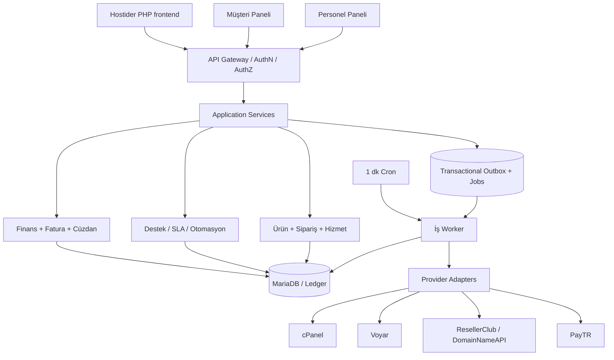
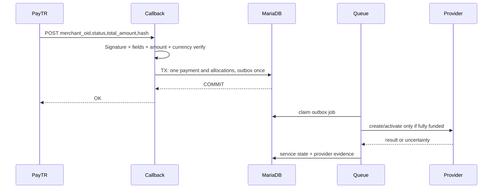

# Hostider Automation V1.0 — Birleştirilmiş Master Specification

> Ayrı düzenlenebilir teknik belgeler, başlangıç SQL taslağı, JSON sözleşmeler ve kullanıcıdan gelen Voyar SDK paketi geliştirme ZIP dosyasındadır. Bu dosya okunabilir birleşik teknik şartnamedir; çalışan uygulama değildir.

# Hostider Automation — V1.0 Master Specification

**Durum:** Onaylı iş kararlarına dayanan teknik tasarım tabanı; henüz uygulama kodu değildir.  
**Tarih:** 22 Ekim 2026  
**Amaç:** Hostider'ın WHMCS'den kontrollü ayrılması. Sadece kurum içi kullanım.  
**Teknoloji hedefi:** PHP 8.3+, MariaDB 10.11+ tercih, paylaşımlı hosting, 1 dakikalık cron, modüler monolit.  
**Öncelikler:** finansal doğruluk > veri kaybını önleme > güvenlik > operatör deneyimi > performans > gösterişli özellikler.

## Okuma sırası
1. `docs/01_DECISIONS.md` — yedi turdan kesin iş kararları, öncelik ve çakışma çözümü.
2. `docs/02_REQUIREMENTS.md` — kapsam, aktörler, iş gereksinimleri ve V2 sınırları.
3. `docs/03_ARCHITECTURE.md` — modüler yapı, olaylar, kuyruk, güvenlik, dağıtım.
4. `docs/04_DATA_MODEL.md` — ana varlıklar, ilişkiler, veri bütünlüğü.
5. `docs/05_FINANCE_AND_PRICING.md` — döviz, ödeme, cüzdan, kasa ve faturalandırma.
6. `docs/06_WORKFLOWS.md` — durum makineleri, iptal, transfer, domain, yenileme.
7. `docs/07_PROVIDER_CONTRACTS.md` — PayTR, Voyar, cPanel, ResellerClub, DomainNameAPI.
8. `docs/08_SUPPORT_CENTER.md` — destek sisteminin ayrıntılı şartnamesi.
9. `docs/09_API_AND_SCREENS.md` — API ilkeleri, yetki matrisi, sayfa haritası.
10. `docs/10_OPERATIONS.md` — kurulum, staging, yedek, güncelleme, güvenlik.
11. `docs/11_MIGRATION.md` — WHMCS'den aktarım ve geri dönüş.
12. `docs/12_ROADMAP.md` — bağımlılıklar ve aşamalı teslim planı.
13. `docs/13_ACCEPTANCE_TESTS.md` — Gherkin benzeri kabul testleri ve yayın kapıları.
14. `docs/14_OPEN_VALIDATIONS.md` — sağlayıcı bazlı doğrulama listesi; varsayım ≠ gerçek.
15. `AGENTS.md` — geliştirici/AI için davranış sözleşmesi.
16. `sql/001_core_schema_blueprint.sql` — kritik tablolar için *başlangıç* DDL taslağı; tamamlanmış üretim migrasyonu değildir.
17. `contracts/` — örnek sağlayıcı yetenekleri ve hata sözleşmesi.
18. `prompts/` — geliştirmeyi fazlara ayıran başlangıç talimatları.
19. `references/voyar-api-client-user-provided.zip` — kullanıcının gönderdiği özgün Voyar PHP SDK referansı; canlı davranış ve güvenlik kontrolü bekliyor.

## Normatif dil
- **MUST / ZORUNLU:** V1 yayın engelleyici gereksinim.
- **SHOULD / ÖNERİLEN:** gerekçeyle ertelenebilir veya değiştirilebilir.
- **MAY / OPSİYONEL:** zorunlu olmayan geliştirme.
- **GATE / DOĞRULAMA KAPISI:** canlı sağlayıcı API'si/ortam/uyumluluk görülmeden kesin kabul edilemez.

## Kaynak hiyerarşisi
1. Kullanıcının 1–7. turda kesinleştirdiği iş kararları; sonraki karar aynı konuyu değiştiriyorsa en güncel karar.
2. Bu paketteki finansal/güvenlik değişmezleri (iş kararlarını ihlal etmeden uygulama yöntemi).
3. Resmi API belgeleri ve kullanıcıdan gelen Voyar SDK dosyası — entegrasyon davranışlarının teknik kanıtı, canlı kabiliyet garantisi değil.
4. Uygulama sırasında yazılı olarak kabul edilmiş ADR'ler ve test edilmiş özellikler.

## Sahiplik ve kullanış
Bu paket çalışma tasarımıdır; kullanıcı API anahtarlarını, canlı DB dump'ını ve şifrelerini bu dosyalara koymamalıdır. Kod üretimi, testler, şema doğrulaması ve canlı sağlayıcı onayı henüz yapılmış değildir.


---

# 01 — Nihai karar defteri ve çelişki çözümü

Tüm maddeler kullanıcı onaylıdır; metinde `tasarım çıkarımı` diye belirtilen alt kurallar ise uygulama için önerilen teknik normalleştirmedir. Sonradan verilen karar, aynı konudaki önceki kararı değiştirir.

## D1 — Proje, çalışma ortamı, sınırlamalar
- Sadece Hostider kullanacak; dışarıya lisans/SaaS/multi-tenant satış yok.
- Native PHP 8.3+ ve MariaDB, paylaşımlı hosting üzerinde 1 dakikalık cron.
- API tabanlı, yenilemesiz UI; ayrı müşteri ve admin paneli; ana Hostider PHP sitesi API ile bağlanır.
- V1 sağlayıcıları: PayTR, ResellerClub, DomainNameAPI, cPanel/WHM, Voyar. V2: iyzico, kayıtlı kart, Plesk, Proxmox.

## D2 — Finans, ödeme ve vergi
- PayTR öncelikli; EFT/havale ve manuel onay; V1 müşteri kredisi/cüzdanı, kısmi+karma ödeme.
- Tam ödeme olmadan otomatik aktivasyon yok. Manuel kurulum kararı ürün bazında ayrıca bulunur.
- Resmi e-belge harici kesilip müşterinin belge detayına güvenli PDF yüklenir; uygulama ödeme talebi/proforma oluşturur.
- Birden çok para birimi; müşteri **hesap para biriminde** sipariş/ödemeye devam eder. Hesap USD ise USD, TRY ise TRY tahsil edilir (ödeme sağlayıcısının gerçek para birimi kabiliyeti GATE).
- Ürünün tanımlı temel parası USD olabilir; TRY fiyatı otomatik güncel kura çevrilir, özgün USD fiyatı değişmez.
- Her ürünün fiyatlama stratejisi ayrı seçilir: kurdan dönüşüm, sabit müşteri-parası fiyatı veya kaynak para biriminde ayrı döngü fiyatı. Aynı stratejinin vergi dahil/hariç kuralı ürün/kategori önceliklidir.
- Tek müşteri cüzdanı, **hesap parası** ile tutulur. Farklı para yatırıldığında o andaki kur+farkla dönüştürülür; iki tarafın özgün değerleri immutable kayda girer.
- Müşteri hesabının para birimi sadece yönetici onayıyla değiştirilir, açık işlemler uzlaştırılır, cüzdan dönüştürülür; eski ödeme talepleri ve faturalar değişmez.
- 15 dakika geçerli teklif; **ödeme talebi oluştuğunda tutar/kur/vergi sabitlenir.** Kısmi ödeme aynı ödeme talebi üzerinde kalır, fiyat tekrar yazılmaz.
- İadede orijinal tahsilat para birimi ve tutarı ile ürünün iade koşulları esas; cüzdana farklı para girişinde ayrı anlık dönüşüm kaydı.
- Satış fiyatları yeni maliyetle otomatik önerilir fakat onaysız yayınlanmaz. Mevcut abonelik fiyatı/koruma/bildirim politikası ürün veya hizmet bazında.
- Cüzdan harcamaları ve diğer ödeme yolları aynı ödeme talebine dağıtılabilir; çift tahsilat kayıtları engellenir.
- Tek kasa görünümü, kategorili gelir/gider, tekrarlayan gider, manuel işlemler; muhasebe defteri / ödeme ledger / müşteri yükümlülüğü verileri mantıken ayrıdır.

## D3 — Ürün, sipariş ve hizmet
- Ana ürün + varyant + seçenekler + bağımlı/bağımsız, tek seferlik/tekrarlayan eklentiler.
- Her döngünün fiyatı bağımsız olabilir: 30 gün, takvim ayı, özel süre; tanım ürün bazında.
- Siparişin otomatik/manüel aktivasyonu ürün/kategori politikasıyla belirlenebilir.
- Yenileme/askıya alma/silme politikası alan bazında global → kategori → ürün → hizmette izin verilen istisna; kural mirası NULL=inherit anlamıyla çalışır.
- Hizmet bazında cüzdanla otomatik yenileme müşteri tercihine bağlı.
- Uyumluluk varsa kalan süreye göre yükseltme farkı ve tahsilat sonrası uygulama; düşürme anında veya dönem sonunda; kredi politikası yapılandırılır.
- Promosyon: ürün, kategori, müşteri, süre, kullanım limiti, ilk/tekrar eden indirim ve birleştirme.
- Transfer: talep gönderen ve alıcı karşılıklı onaylar, **açık borçlu hizmet devredilemez**, bildirim+denetim+sahiplik tarihi korunur.
- Cloud: hazır/özel konfigürasyon, müşteri yalnız yönetici izinli OS/lokasyon/kaynak sınırlarında seçim yapar.
- Cloud: aylık/ürün döngüsüyle müşteri satış, sağlayıcıda hedef saatlik/fiilî maliyet, özel iptal/iade kuralı, hemen veya dönem sonu iptal.
- Gecikme: bildirim → grace → doğrulamalı kapatma; sağlayıcının gerçekten faturalamayı durdurduğu teyit edilmelidir.
- Domain: uzantı bazında birincil/alternatif registrar; yalnız kesin başarısızlık + fiyat/TLD/contact uyumu sonrası alternatif; belirsiz sonuçta otomatik ikinci deneme yok.

## D4 — Destek Merkezi
- Tamamen özelleştirilebilir departmanlar, varsayılan şablon.
- Departman bazında çalışma takvimi/tatil/SLA, manuel/round-robin/en az iş yükü atama.
- Doğrulanmış müşteri e-postaları otomatik, bilinmeyenler inceleme kuyruğuna.
- Müşteri öncelik seçebilir; personel ve kurallar değiştirebilir.
- Departman bazında otomatik kapanma ve yeniden açılma.
- Toplu arıza/incident ile bağlantılı ticket'lar; çözüm sonrası puan+opsiyonel yorum.
- Koşullu kural motoru: departman/öncelik/saat/etiket/müşteri/hizmet.
- V1 kanalları müşteri paneli + iki yönlü e-posta; personel 2–5.
- Departman/rol bazlı görme, yanıtlama, yönetme ayrı izinler; canlı güncelleme ve operatör dostu arayüz.

## D5 — Güvenlik, kimlik ve arayüz
- Hazır roller+özelleştirilmiş rol+işlem bazlı RBAC; müşteri alt kullanıcılarına davet ve kapsamlı yetki.
- Yönetici 2FA zorunlu; müşteride müşteri hesabı bazında 2FA politikası (zorunlu/opsiyonel).
- Yetkili personel müşteri şifresi olmadan denetimli destek oturumu açabilir; impersonation aktörü loglanır.
- Kritik yönetici işleminde yeniden doğrulama ve ayrıntılı onay. İkinci kişi onayı varsayılan gereklilik değildir.
- API anahtarları yetki kapsamlı, süresi sınırlı ve iptal edilebilir; oturumlar çoklu cihaz, liste/uzaktan çıkış/şüpheli giriş uyarısı.
- Modern admin: global arama, hızlı işlemler, sekmeler, kişiselleştirilebilir görünüm.

## D6 — Kurulum, yedek, aktarım
- Staging ve production veri/dosya/anahtar düzeyinde ayrı; staging gerçek sağlayıcılara mali sonuç üretmez.
- Web kurulum sihirbazı ve opsiyonel CLI.
- Yönetici onaylı imzalı/sürümü tanımlı güncelleme; ön kontrol, yedek, bakım modu, kontrollü migration, doğrulama.
- Gece tam yedek; yerel + seçilebilir dış hedef (Google Drive, S3 vb.), şifreli; ayarlanabilir 14 günlük/8 haftalık/12 aylık retention.
- Kurtarma noktası: teknik olarak mümkünse saatlik veritabanı kopyası veya PITR; bütünlük ve izole geri yükleme testleri.
- Sağlık uyarısı: panel/e-posta/isteğe bağlı webhook.
- WHMCS: salt-okunur DB/dump + ekler/dosyalar; API ile uygun doğrulama; parola hash doğrulanabiliyorsa rehash-on-login, değilse sıfırlama.
- Prova → fark analizi → kısa dondurma → son veri aktarımı → tek aktif provisioning/billing motoru.
- WHMCS geçici, otomasyonu/cron'u kapatılmış ve erişimi sınırlandırılmış arşiv (lisans ve veri saklama uygunluğu kontrol).

## Çelişki çözümü — kesin normalleştirme
- **Tek cüzdan vs çoklu para:** tek hesap para biriminde finansal yükümlülük; yabancı tutar dönüşümde kalıcı FX fişiyle izlenir. Kur farkı geçmiş cüzdan kaydını geriye dönük değiştirmez.
- **USD kaynak fiyat vs müşteri hesap para birimi:** ürün kaynak para birimi farklı olabilir; checkout yalnız müşterinin hesap para biriminde; ekran alternatif döviz gösterimi bilgilendirme amaçlı olabilir.
- **15 dk quote vs sabit fatura:** quote 15 dk; oluşturulmuş ödeme talebi immutable; sonraki dönem farklı hesaplanır. Tam ödenmemiş ödeme talebi için iptal/yeniden düzenleme yalnız kayıtlı düzeltme iş akışıyla yapılır.
- **Provider 'prepaid' vs hedef 'ondemand':** Voyar SDK iki tipi örneklendiriyor. Saatlik maliyetin gerçekten oluşması ve sonlandırmayla durması canlı GATE; ön ödemeli sağlayıcı hesabıyla bu ticari model varsayılamaz.
- **İade kaynağı vs cüzdan:** PayTR iadesi orijinal para/ödeme referansıyla; cüzdan kredisi verilen tutar dönüştürülürse ikinci FX olayı izlenir.
- **Staging vs gerçek içeri aktarılan veriler:** test aktarımında canlı PII maskeleme ve dış bağlantıları devre dışı bırakma.
- **Ürün kapsamı vs sağlayıcı kapasitesi:** capabilities matrisi operasyon başlamadan kontrol edilir; desteklenmeyen yükseltme/silme/dönüşüm müşteri panelinden doğrudan çalıştırılmaz.
- **Sahiplik transferi vs eski kayıtlar:** müşteri sahipliği zaman dilimli; eski finans belgesi eski müşteriyle kalır; destek gizliliği de geçmiş sahipliğe göre denetlenir.


---

# 02 — Ürün Gereksinimleri (PRD)

## Paydaşlar ve aktörler
- **Müşteri**: bireysel/kurumsal hesabın fatura sorumlusu; hesabın para birimi ve cüzdanı vardır.
- **Alt kullanıcı**: bir veya birden çok müşteri hesabına belirli izinlerle bağlı gerçek kişi; fatura/ödeme/destek/hizmet alanları ayrışır.
- **Hostider personeli**: görev kapsamı ve departman yetkili, auditable; 2–5 personel ilk ölçek.
- **Süper yönetici**: ayarlar, güvenlik, geri alma, riskli işlemler.
- **Otomasyon**: sistem aktörü; işlemleri orijinal tetikleyiciye `causation_id` ile bağlar.
- **Sağlayıcı**: cPanel, domain registrarı, Voyar veya ödeme kaynağı; tekil harici işlem ve kaynak id'leri.

## P0 yayın engelleyici kapsam
- FR-ID: kayıt, giriş, parola sıfırlama, 2FA politika, yetki, alt kullanıcı, personel oturumları, şüpheli giriş, auditable impersonation.
- FR-CATALOG: ürün/varyant/opsiyon/addon, bağımsız fiyat döngüleri, döviz kuru ve vergiler, promosyon, müşteri hesap parası checkout.
- FR-CHECKOUT: 15 dk teklif, ödeme talebi snapshot, kısmi/karma ödeme, ödeme mutabakatı.
- FR-PAY: PayTR iFrame/token/callback, manüel havale onayı, cüzdan yükleme/harcama/iadeler; idempotency.
- FR-BILL: proforma/ödeme talebi, masraf/kasa, resmî PDF belgesi yükleme, fatura geçmişi, para birimi ve yasal metaveri.
- FR-SERVICE: ürünle ilişkilendirilmiş hizmet yaşam döngüsü, aktivasyon onayı, sağlayıcı kaynak eşleşmesi, planlı yenileme, gecikme/suspend/terminate.
- FR-CPANEL: birden fazla WHM, hesap oluştur/askıya al/aç/paket değiştir/sonlandır, dış kaynak senkronizasyonu, kapasite+sağlık+ağırlık atama.
- FR-DOMAIN: uzantı bazında registrar, sorgu/kayıt/yenileme/transfer, nameserver, EPP/kilit (TLD özelliklerine göre), kayıt sonrası durumu doğrulama.
- FR-VOYAR: katalog, hazır/özel sunucu quote, oluştur, durumu göster, güç yönetimi, OS reinstall, yenileme, iptal; hesap/capability doğrulaması şart.
- FR-SUPPORT: panel ve e-posta ticket, mesaj/ek/dahili not, SLA, departman takvimleri, personel atama, rule engine, incident, CSAT, raporlama, çakışma engeli.
- FR-NOTIFY: bildirim şablonları, e-posta ve panel bildirimleri, kuyruk, şablon versiyonu, hata/retry.
- FR-OPS: staging-prod izolasyonu, installer, backup, updater, izleme, maintenance mode, WHMCS aktarımı.

## P1 (V1'i tamamlayan uygulama içi kalite)
- Müşteri ve hizmet zaman akışı, güvenli dosyalar, sekmeli paneller, güçlü arama ve filtreler.
- İşlem loglarında correlation/causation ID; provider request/response maskelemesi.
- Müşteri hizmet transferinde bildirim, tek kullanımlık süreli onay ve borç denetimi.
- Yenileme onay uyarıları, maliyet marj raporları, ödeme defteri mutabakatı.

## Kesin kapsam dışı (V2)
- iyzico, kayıtlı kart/tekrarlayan kart tahsilatı, Plesk, Proxmox; genel dağıtım/lisanslama, eklenti marketplace.
- WhatsApp/SMS/canlı sohbet destek kanalı; API dışı web scraping işlerini V1 ile karıştırma.
- Harici e-fatura/e-arşiv oluşturma entegrasyonu; kullanıcının manuel resmî PDF akışı korunur.

## Kullanıcı hikayeleri
- **Müşteri:** USD temel fiyatlı ürünü TRY hesapta güncel kurdan görürüm; 15 dk teklifi onaylar, kesinleşmiş TL ödeme talebini PayTR + cüzdanla kapatırım.
- **Müşteri:** Destek talebime hizmet bağlarım; gelen personel cevabını panelden ve e-postadan görürüm.
- **Müşteri:** Bir hizmeti başka hesaba devrederim; alıcı süreli token'la kabul eder; borç varsa transfer engellenir.
- **Müşteri:** Otomatik yenilemeyi hizmet bazında açar, cüzdan yeterliyse yenilemenin gerçekleştiğini görürüm.
- **Operatör:** cPanel / Voyar işleminde sonucu belirsiz işi inceleme ekranından görürüm, tekrar denemeden önce dış kaynağı sorgularım.
- **Operatör:** Tek support ekranında ticket, SLA, müşteri geçmişi ve hizmet durumuna ulaşırım.
- **Finans:** PayTR tahsilatına ait sipariş, cüzdan hareketi, proforma ve resmî PDF birbirine bağlıdır; kasa gelirini iki kez yazmam.
- **Yönetici:** Güncel Voyar maliyetlerinden önerilen fiyatları gözden geçirip yeni sürümü onaylarım; mevcut ödenmiş döneme dokunmam.
- **Yönetici:** Güncellemeden önce geri yüklenebilir yedek ve staging doğrulaması görürüm.

## Kabul koşulu önceliği
Finansal tutarsızlık, yetki açığı, tekrar provisioning, veri kaybı veya canlı ortamdan test sağlayıcısına yanlış çağrı = **release blocker**. Görsel kozmetik ve ileri rapor filtreleri release blocker değildir; destek sisteminin çekirdek fonksiyonları blocker'dır.


---

# 03 — Sistem mimarisi

## 1. Genel yaklaşım
- Modüler monolit: tek PHP deploy, tek transaction alanı, birbirinden ayrılmış bounded context'ler.
- PHP 8.3+; PDO ve InnoDB; MariaDB 10.11+ hedef; gereksiz framework ve sürekli açık worker zorunlu değil.
- Paylaşımlı hostingde 1 dk cron ile `queue:work --once`, `schedule:run`, `health:check` benzeri kısa ömürlü komutlar. HTTP güvenli idempotent işlerde API üzerinden; e-posta/sağlayıcı işleri cron üzerinden.
- Sunucu HTML render + hafif JS fetch/DOM bileşenleri; tüm etkileşimlerin versiyonlu JSON API karşılığı var. Tam sayfa refresh'e bağımlı değil; SPA framework şart değil.
- Arayüz katmanı → application service → domain/service policy → repository/transaction/outbox → adapters. Finans ve provisioning iş kuralları controller'da yaşamaz.



## 2. Modüller ve veri sahipliği
- Identity & Access: kullanıcı, müşteri rolü, 2FA, cihaz/oturum, API anahtarı, impersonation.
- Catalog & Pricing: ürün, varyant, opsiyon, fiyat listesi, vergi, FX snapshot, promosyon.
- Orders & Billing: sipariş, ödeme talebi/proforma, period, resmi fatura eki.
- Payments & Ledger: sağlayıcı attempt/callback, tahsilat dağılımı, wallet, refund, muhasebe hareketleri.
- Services & Provisioning: hizmet, konfigürasyon snapshot, sağlayıcı kaynak bağlantıları, yenileme, transfer, lifecycle.
- Registrars/Hosting/Compute: adapter arayüzleri; dış sistem DTO'ları bu sınırda dönüştürülür.
- Support: ticket, departman, e-posta, SLA, incident, CSAT.
- Notifications & Automation: şablon, outbox, scheduled notifications, rules.
- Operations: backup, update, health, audit, import.

## 3. Transaction sınırları ve asenkron işleme
1. Gelen olay doğrulanır: kullanıcı yetkisi / callback HMAC / payload geçerliliği.
2. DB transaction açılır; iş state transition yapılır, idempotency kaydı ve outbox event birlikte commit edilir.
3. API başarısı DB commit'inden sonra döner. Provider network çağrısı bu transaction'ın **dışındadır**.
4. Worker işi claim eder (lease, attempts, backoff, fencing token). Provider'e yazar; dönen sonucu normalize eder.
5. `SUCCESS` durumda harici resource ID ve kanıt saklanır. Timeout/undefined -> `UNKNOWN` ve reconciliation. Kesin `FAILED` retry politikası ayrıca belirler.
6. Event consumer'lar en az bir kez teslim alabilir; tüketiciler kendi idempotency kaydına sahip olmalıdır.

## 4. İdempotency ve concurrency
- HTTP mutasyon `Idempotency-Key` (istek+actor+scope) kullanır; sunucuda canonical request fingerprint ile eşleştirilir.
- PayTR `merchant_oid` eşsiz `payment_attempt` üstündedir; callback tekrar edilirse yeni ödeme oluşturulmaz.
- Sağlayıcı: `provider_operation_uuid`, hedef hizmet ve operation kind için unique/locked in-flight kuralı; servis oluşturma/transfer/terminate aynı anda koşmaz.
- Provider API dışarıdan idempotency desteklemiyorsa ikinci `create` çağrısı otomatik **yasak**; önce görünür kaynak sorgusu/reconciliation.
- Bakiye/harcama/ödeme tahsilatı tek DB transaction + satır kilidi + toplam kısıtı ile atomiktir.
- Optimistic lock için `version` alanı; update `WHERE id=? AND version=?` başarısızsa 409.
- Saat/kur/süre normalleştirmesi: UTC storage, IANA bölge takvimi, decimal-safe fiyat ve FX snapshot.

## 5. Scheduler ve queue
- Tablolar: `jobs`, `job_attempts`, `job_locks`, `outbox_events`, `inbox_events`, `scheduled_tasks`, `dead_letters`.
- Job alanları: id, type, payload_json, queue, run_after, status, attempts, max_attempts, lease_token, leased_until, dedupe_key, correlation_id, last_error_sanitized.
- 1 dk cron; kısa zaman/bellek sınırı; en az iki cron çakışması için kilitleme. Terminal/SSH olmadan web cron giriş noktası gerekiyorsa HMAC+IP+timestamp ile korunur; halka açık endpoint kontrolsüz çalışmaz.
- Kesin başarısız: iş dead letter'a taşınır; kullanıcıya yanlış aktif durum bildirilmez.
- Kritik SLA/ödeme job'ları, düşük öncelikli metriklerden önce işlenir.

## 6. Güvenlik ve gözlemlenebilirlik
- Oturum çerezi Secure/HttpOnly/SameSite; CSRF, rate-limit, XSS ve içerik güvenlik ilkesi; parola Argon2id mümkünse, PBKDF? yok; hash sürümleyerek rehash.
- Yönetici TOTP 2FA ve recovery, step-up auth. Müşteri hesabı politikası zorunlu/opsiyonel. İsteğe bağlı passkey V2 adayı.
- Yetki: endpoint + kayıt düzeyi (`customer_id`, `department_id`, `resource_owner`) kontrolü; deny by default; yetki önbelleği sürümlü.
- `impersonation` kısa ömür, sebep girme, actor+effective principal+scope audit; şifre/sanal kart/2FA/transfer onayı gibi riskli işlemleri varsayılan engelle.
- Kredi kartı PAN/CVV toplanmaz; PayTR hosted iFrame kullanılır.
- Secrets libsodium / envelope key; anahtar dosya/konfigürasyon webroot dışında; sürümleyerek rotate; audit log sanitization.
- Her işlem `trace_id`, `causation_id`; PII maskeleme; sağlayıcı ham hata response'u yalnız güvenli yönetici teşhisinde sınırlı gösterilir.
- Sağlık kontrolleri: son cron, queue backlog, dead-letter, payment callback drift, registrar/WHM/Voyar adapter auth, disk/database/backup age, mail failures.

## 7. Performans hedefi ve sınırlar
- Ölçek tasarımı başlangıçta <50 müşteri; iş tasarımında 1000+ kayıt/dönem büyümesine engel yok.
- Arayüz listeleri sayfalama/filtre/indeks kullanır; sayaçlar özet tablo+geçerlilik zamanı.
- Aktif ticket ekranında incremental polling (başlangıç ~5–10 sn, dinamik); diğer ekranlarda daha seyrek. WebSocket zorunlu değil.
- Büyük yedek/dump/ekler HTTP request içinde tutulmaz; job chunks, üst sınırlar ve checkpoint.
- Üretim öncesi ölçülecek SLO'lar: API p95, en uzun queue lag, webhook gecikmesi, başarılı job oranı, mail processing lag. Sayısal eşikler ölçülüp onaylanmadan 'garanti' yazılmaz.


---

# 04 — Mantıksal veri modeli ve tutarlılık

## Tasarım sözleşmesi
- MariaDB InnoDB; bütün dış referanslar explicit FK veya kontrollü polimorfik `entity_type/entity_id` registries üzerinden.
- İç ilişkiler BIGINT UNSIGNED; dış dünyaya tahmin edilemeyen public ID (UUIDv7/ULID veya güvenli random ID) kullanılır.
- Tüm domain entity'lerde `created_at`, `updated_at`; optimistik kilit gerektirenlerde `version`; soft-delete yalnız hukuki/iş gereksinimine uygun alanlarda. Finans fişleri **silinmez**.
- UTC `DATETIME(6)`, IANA timezone ayrı; para için minor units BIGINT ve currency exponent; fiyat/saatlik oranlar `DECIMAL(24,10)` gibi kesin decimal ve tek noktadan final rounding. Kur `DECIMAL(24,12)`; php float kesin finans mantığında yok.
- Tutarlar: hesapla (precision yüksek), vergi/indirim dizisini kurallı yuvarla, para birimine indir, verilen satış fiyatını immutable snapshot yap.
- Idempotency ve provider external id üzerinde unique kısıt; müşteri aidiyet kontrolü uygulama katmanında, kritik ilişki FK ile.

## Önerilen tablolar (çekirdek)
| Modül | Tablolar ve önemli alanlar |
|---|---|
| Identity | `users(id,email,password_hash,verified_at)`, `customers(id,name,billing_currency)`, `customer_users(user_id,customer_id,role_id)`, `staff_roles`,`permissions`,`role_permissions`,`user_sessions`,`two_factor_factors`,`api_credentials`,`impersonation_sessions` |
| Catalog | `product_categories`, `products`, `product_variants`, `option_groups`, `option_values`, `product_addons`, `product_prices(product_id,variant_id,billing_cycle,currency,amount_minor,pricing_method,version)`, `product_provider_mappings`, `price_publications`, `pricing_rules`, `exchange_rates`, `tax_rules`, `promotion_rules`, `promotion_redemptions` |
| Checkout | `quotes(id,customer_id,expires_at,currency,total_minor,fx_snapshot,pricing_snapshot)`, `orders`, `order_items`, `order_adjustments`, `payment_requests`, `payment_request_lines` |
| Finance | `payment_attempts`, `payments`, `payment_allocations`, `wallet_allocations`, `wallet_accounts`, `wallet_entries`, `wallet_fx_conversions`, `refunds`, `ledger_journals`, `ledger_lines`, `cash_categories`, `cash_entries`, `recurring_cash_rules`, `official_invoice_documents` |
| Service | `services`, `service_periods`, `service_resources(provider_account_id,external_id)`, `service_configs`, `service_prices`, `renewal_policies`, `lifecycle_operations`, `provider_operations`, `service_transfers`, `service_transfer_approvals`, `service_ownership_history`, `service_events` |
| Domain | `domain_tlds`, `domain_tld_provider_rules`, `domains`, `domain_contacts`, `domain_locks`, `domain_operations`, `domain_transfer_events` |
| Hosting | `hosting_servers`, `hosting_packages`, `hosting_server_health`, `hosting_capacity_snapshots`, `hosting_accounts` |
| Cloud | `cloud_products`, `cloud_quote_snapshots`, `cloud_capabilities`, `cloud_usage_costs`, `cloud_billing_reconciliations`, `cloud_vm_resources` |
| Support | `support_departments`, `support_department_members`, `support_business_calendars`, `support_calendar_exceptions`, `support_sla_policies`, `support_sla_clocks`, `support_tickets`, `support_messages`, `support_attachments`, `support_ticket_links`, `support_assignments`, `support_mailboxes`, `support_inbound_messages`, `support_email_review`, `support_outbound_messages`, `support_incidents`, `support_incident_tickets`, `support_automation_rules`, `support_rule_executions`, `support_ratings`, `support_drafts` |
| Infrastructure | `jobs`, `job_attempts`, `outbox_events`, `inbox_events`, `dead_letters`, `notifications`, `notification_templates`, `audit_logs`, `security_events`, `backups`, `restore_tests`, `schema_migrations`, `deployment_history`, `migration_mappings` |

## Temel ilişkiler
- `Customer 1—N CustomerUsers`, `Customer 1—N Orders`, `Customer 1—N PaymentRequests`, `Customer 1—1 WalletAccount (currency=current customer currency)`.
- `Product 1—N Variants 1—N Prices`; fiyat yayın sürümleri immutable.
- `Order 1—N OrderItems`; bir order item bir veya daha çok `Service` ortaya çıkarabilir; servis geçmişi eski siparişle kalıcı bağlı.
- `PaymentAttempt 0..1—1 Payment`; `Payment N—M PaymentRequest` `payment_allocations` ile; **cüzdan borçlandırmaları** ayrı `wallet_allocations` ile payment request'e bağlanır. Ödeme kaynakları kupon değil, bakiye/PayTR/havale olarak ayrıdır.
- `PaymentRequest N—M ServicePeriod` mantıksal `billing_targets` aracılığıyla; yenilemeler yeni `ServicePeriod` üretir.
- `Service N—1 current Customer` ve `Service 1—N OwnershipHistory`; eski müşteriye ait faturalar sahiplik aktarımında hareket etmez.
- `Service 1—N ProviderOperation`; `Service 1—N ServiceResources` ancak aynı anda bir aktif birincil kaynak kuralı uygulanır.
- `Ticket N—1 Customer`; `Ticket N—M Service,Invoice,Order,Domain` görme izniyle; `Ticket 1—N Messages`.
- `SupportIncident N—M Tickets` ve birincil platform olayı, ticket'ların SLA'sından bağımsızdır.

## Finansal tutarlılık kuralları
- Ledger dengeli çift taraflı defter gibi muhasebeleştirilebilir (debit=credit, aynı currency/valuation). V1 UI tek kasa; ayrı finansal kayıt sistemi saklı tutulur.
- Her `payment_attempt` benzersiz `merchant_oid`; başarılı PayTR callback en fazla bir `payment`, her business allocation unique `(payment_id, payment_request_id,allocation_reference)`.
- `wallet_entries` yalnız append: topup pending → confirmed credit, reservation/charge debit, cancellation compensation credit; eksi bakiye izinsiz oluşamaz.
- Refund max = ilgili orijinal payment'ın daha önce iade edilmemiş tahsilat parçası; cüzdan harcamasının geri alımı yeni wallet credit fişi.
- Her ödeme talebi bir para biriminde ve değişmez `total_minor`/`tax_minor`/`fx_snapshot`; geçmiş döviz kurları yeniden fiyatlandırma tetiklemez.
- Product price update yeni `price_publication` üretir; yenileme anında aktif policy değerlendirilip yeni dönem snapshot'ı oluşturulur.
- Promosyon kullanımı quota ve müşteri limitleri DB transaction içinde atomik rezervasyon/commit ile tutulur.
- Provider cost `cloud_usage_costs` ayrı tablodur; müşteri tahsilatının kendisi değildir. Sağlayıcı faturası mutabakatıyla ilişkilenir.

## Durum/işlem kısıtları
- `service.status`: `PENDING_PAYMENT`, `PENDING_APPROVAL`, `QUEUED`, `PROVISIONING`, `ACTIVE`, `SUSPENDED`, `CANCEL_SCHEDULED`, `TERMINATING`, `TERMINATED`, `FAILED`, `UNKNOWN`.
- `provider_operations.status`: `PENDING`, `RUNNING`, `SUCCESS`, `DEFINITIVE_FAILURE`, `UNKNOWN`, `MANUAL_REVIEW`.
- `payment_requests.status`: `DRAFT`, `ISSUED`, `PARTIALLY_PAID`, `PAID`, `VOIDED`, `REFUNDED_PARTIAL` (iade durumu ayrıca tutulur).
- `service_transfers.status`: `REQUESTED`, `OWNER_APPROVED`, `RECIPIENT_APPROVED`, `READY`, `COMPLETED`, `EXPIRED`, `REJECTED`, `CANCELLED`, `BLOCKED_DEBT`.
- `support_tickets`: görünen özel status ID; sistem kategorileri sabit `NEW,WAITING_STAFF,WAITING_CUSTOMER,ON_HOLD,RESOLVED,CLOSED`.
- Durumlar serbest string set edilmez; transition service atomik olay üretir.

## DB indeksleri ve referanslar
- `users(email_normalized)` UNIQUE; `customer_users(customer_id,user_id)` UNIQUE.
- `services(customer_id,status,next_due_at)`, `service_resources(provider_account_id,external_id)` UNIQUE.
- `provider_operations(operation_uuid)` UNIQUE; `(service_id,kind,status)` seçici indeks; in-flight concurrency ayrıca row lock.
- `payment_attempts(provider,merchant_oid)` UNIQUE; `payments(provider,provider_transaction_id)` UNIQUE NULL değilse.
- `quotes(customer_id,expires_at)`, `payment_requests(customer_id,status,due_at)`.
- `support_tickets(customer_id,updated_at)`, `(department_id,status_id,assigned_user_id,updated_at)`, `support_messages(ticket_id,created_at)`, `support_inbound_messages(mailbox_id,message_hash)` UNIQUE.
- `jobs(queue,status,run_after)`, `outbox_events(publish_status,created_at)`, `jobs(dedupe_key)` unique only when meaningful.

## Migration kuralları
- Her migration idempotent? Migration framework tek uygulamalı; migrations apply-once unique checksum, transaction destekleyen DDL ve MariaDB sınırlamalarını bil.
- **Expand → backfill → verify → switch → contract**; destructive alter başka sürüme kalır.
- Üretimde otomatik downgrade garantisi verilmez; veritabanı snapshot'ıyla rollback planı kurulmalıdır.
- `sql/001_core_schema_blueprint.sql` yalnız örnek kritik tablolar; geliştirici tüm şema/constraint/testleri üretmekle yükümlüdür.


---

# 05 — Finans, döviz, ödeme ve fiyatlandırma normları

## Fiyatın kaynakları
Her ürün/döngü için `pricing_strategy`:
1. `SOURCE_FX`: örn. 3 USD kaynak fiyatı; TRY hesap için onaylı FX feed + ürün farkıyla hesaplanan TRY.
2. `FIXED_PER_CURRENCY`: hesap para biriminde elle tanımlı sabit fiyat; yoksa tanımlı fallback politikası.
3. `CUSTOM_FORMULA`: açıkça admin tarafından kabul edilmiş CPU/RAM/disk tablosu veya maliyet+marj kurallı satış önerisi; otomatik publish yok.

Fiyat kaynağına `source_currency`, `source_amount_decimal`, `billing_cycle`, `fx_rate_id`, `spread_rule`, `tax_rule`, `product_price_version` bağlanır. Ara hesap `decimal`; nihai ödeme `minor unit` olarak saklanır.

### Örnek fiyat akışı (rakamlar temsili)
- Ürün temel 3.00 USD; müşterinin hesap para birimi TRY.
- Kaynak `USDTRY = 43.000000` ve ürün fiyatlandırma farkı `%2`; varsayılan **satış kuru** 43.86 TRY/USD.
- Vergi hariç fiyat 131.58 TRY, seçilmiş vergi kuralına göre son toplam hesaplanır.
- `quote` oluşturulur: `expires_at = created_at+15 min`, fiyat/kur/vergi snapshot.
- `payment_request` oluşturulduğu an tutar kesinleşir. Bir sonraki yenilemede aktif fiyat politikası yeniden değerlendirilir.
- Hesabı USD müşteri USD tahsil edilir; PayTR'nin bu hesap için seçilmiş gateway para birimini desteklemesi canlı test kapısıdır.

## 15 dakikalık teklif ve belgeler
- `Quote`: geçici seçim/fiyat ve son geçerlilik; quote süresi geçtiyse checkout yeniden fiyatlanır ve müşteri onayı alınır.
- `PaymentRequest`: oluşturulmuş ve muhasebe referansına bağlanmış immutable tutar/para birimi/kurlar/indirim/vergi; yeni kura göre canlı değişmez.
- `Draft` ödeme talebi düzenlenebilir ama her değişimde revision. `Issued` için iptal+yeniden çıkarma veya kayıtlı düzeltme gerekir.
- Sepet fiyatını müşteri tarafındaki gizli inputtan değil, sunucu quote snapshot ve ürün kurallarından hesapla.

## Çoklu döviz ve tek cüzdan
- Her müşterinin tek `billing_currency` vardır. `wallet_account.currency = customer.billing_currency`.
- Yabancı para ile top-up **yalnız dövizle dönüşüm ve gateway uygunluğu doğrulandıktan sonra** cüzdan hesabına aktarılır; orijinal ödeme tutarı / FX rate / spread / net credited immutable kaydedilir.
- Kur dönüşümünde mevzuat, sağlayıcı komisyonu veya bakiye iadesi yükümlülüğü sonuçlarını hukuk/muhasebe teyidi olmadan varsayma; uygulama teknik kayıt tutar.
- Para birimi değiştirme: açık ödeme taleplerini ve rezervasyonları denetle, yönetici step-up auth ve onay, cüzdan tek transaction ile convert, geçmiş faturalar sabit.
- Cüzdan borç değildir? Müşteri yatırdığı fakat tüketmediği bakiye Hostider için yükümlülüktür; kasa gelirine ikinci kez yazılamaz.

## Tahsilat defteri
- PayTR deneme oluşturma -> benzersiz `merchant_oid`; callback hash sabit zamanlı doğrulama, tutar+currency+payment_request referansı mutabakatı, tekrar bildirimlerde no-op.
- `paid_amount < due_amount` ise `PARTIALLY_PAID` ve servis kurulumu başlamaz; `paid_amount == due_amount` halinde ödeme tamamlanmış işlem ve outbox provisioning oluşur.
- Fazla ödeme: sessiz fatura kapatma yok; `UNALLOCATED` veya iade/inquiry işlemi. Taksit tutarı farkları gateway bildirimine göre muhasebeleştirilir.
- Havale onayı kim, ne zaman, referans ve dekont; iki yönetici işleme aynı anda onay verse bir tahsilat kaydedilir.
- Karma ödeme: wallet debit ve PayTR payment ayrı kaynak; `payment_allocations` ile aynı talebi kapatırlar. Ödeme öncesi cüzdan payı reserve edilebilir, başarısızlıkta reserve çözülür.
- Resmi belge: manuel e-fatura/e-arşiv PDF, belge no/tarih/vergi kimlik alanları, yükleyen actor, checksum, belge tipi, erişim kuralı. Bir PDF ne invoice ne ödeme request tutarını geriye dönük düzenler.

## Kasa ve tekrarlayan giderler
- Tek kasa dashboard; işlem kategorileri gelir, gider, düzeltme, transfer türünde. PayTR bloke/bekleyen ödeme ve gerçekleşmiş banka girişleri iki ayrı **gelir** üretmez.
- `cash_entries` aynı `ledger_journal_id` üzerinde tahsilat/gider ile eşleştirilir; manuel hareketler açıklama ve source_reference ister.
- Tekrarlayan giderler kural ve gerçekleşen ödeme kayıtlarına ayrılır; oluşturulan 'ödenecek' kaydı, fiilen ödenmiş gider değil.
- Kârlılık: müşteri hasılatı (vergisiz) - gerçek sağlayıcı maliyeti - komisyon/ek gider; nakit akışı ile kâr farklı rapor.

## İade
- Uygunluk ürün politikası (`none`, `prorated`, `staff_approval`) + hemen/dönem sonu durdurma + veri/hizmet sonuçlarının doğrulanması.
- Orijinal ödeme para birimi ve ödeme referansı ile maksimum kalan iade limiti. PayTR partial refund desteklenebilir (güncel API/sözleşme test edilmeli).
- Karma ödemenin iadede hangi kaynağa nasıl döneceği açık kural: önce ilgili tahsilat kaynaklarına oransal/algoritmik dağılım; kullanıcıya dekont; cüzdan payı wallet credit olarak geri yazılır.
- Cüzdana iade farklı para birimindeyse tarihsel orijinal tahsilatı değiştirme; ayrı kurdan dönüşüm fişi oluştur.
- Bir iadenin iki kez gerçekleşmesi DB unique request/reconciliation ile engellenir.

## Vergi politikası ve uyumluluk
- Ürün/kategori düzeyinde vergi dahil/hariç; vergi oranı ve muafiyet müşteri ülke/şirket bilgisi ve tarihe bağlı sürümlenir.
- Bu doküman vergi hukuku yorumu değildir. E-belge ne zaman düzenlenir, USD/TRY tevsik, iade ve cüzdan uygulaması mevzuat kapsamında mali müşavir onayından geçmelidir.
- Hesap para birimi ile banka ödeme gateway para birimi farklı tutulabilir ama otomatik kabul edilmez; FX ve şirket muhasebesi mutabakatı gerekir.


---

# 06 — Durum makineleri, saga ve istisnalar

## Sipariş / ödeme / servis ayrı state machine
```text
Order: DRAFT -> QUOTED -> AWAITING_PAYMENT -> PAID -> FULFILLING -> FULFILLED
                                                       \-> REQUIRES_APPROVAL
                                                       \-> FULFILLMENT_FAILED
         \-> CANCELLED / EXPIRED (uygun durumlarda)
PaymentRequest: ISSUED -> PARTIALLY_PAID -> PAID (veya VOIDED)
Service: PENDING_PAYMENT -> PENDING_APPROVAL? -> QUEUED -> PROVISIONING -> ACTIVE
                                        \-> FAILED/UNKNOWN -> MANUAL_REVIEW
ACTIVE -> SUSPENDED -> ACTIVE; ACTIVE -> CANCEL_SCHEDULED -> TERMINATING -> TERMINATED
```
- `PAID` customer charge confirmed; `ACTIVE` provider service availability verified. Farklı zamanlarda olur.
- Yönetici onay gerektiren ürün ödeme tamam olsa bile `PENDING_APPROVAL`; onay sonrası job.
- Sağlayıcı `UNKNOWN` durumunda otomatik tekrar `create` yapılmaz; personel+reconciliation.

## PayTR callback saga

- Müşterinin dönüş/başarı sayfası **ödeme kanıtı değildir**.
- Aynı callback iki kez gelirse `OK` ancak para ve provisioning ikinci kez yaratılmaz.
- Callback hash doğrulanmadıysa `OK` ile kabul yok.

## Sağlayıcı işlemleri
- Unified Operation: `operation_uuid, service_id, provider_account_id, action, request_fingerprint, status, external_request_id, external_resource_id, verification_evidence`.
- İstek ve yanıt tarihleri, normalize hata sınıfları: `TEMPORARY`, `DEFINITIVE`, `AUTH`, `RATE_LIMIT`, `UNKNOWN`, `UNSUPPORTED`.
- Ağ timeout: `UNKNOWN`; yanıt gelmedi diye 'başarısız' demek yasak; önce external discover/get.
- Termination: müşteri ve operator için geri alınamaz işlem uyarısı, grace kontrolü, bekleyen işler denetimi, provider kaynak durumunun doğrulanması, hizmet statüsü değişimi.
- Domain registration/renewal/transfer ve Cloud VM create/terminate yüksek mali sonuçlu olduğundan `UNKNOWN` tekrar gönderilmez.

## Yenileme, vade, askıya alma
1. Planlayıcı uygun gün ve cycle policy hesaplar; 30 gün/takvim ayı/özel döngü ayrıdır.
2. Fiyat koruma/bildirim kuralları + aktif price source değerlendirilir; yeni payment request ve snapshot.
3. Otomatik yenileme açıksa cüzdan yeterlilik+reserve+debit atomik, gerekiyorsa sağlayıcı uzatma sonucu doğrulanır.
4. Ödeme yoksa kategoride/üründe tanımlı bildirim ve gecikme; domain için registrar grace ve sona erme ayrı doğrulanır.
5. Cloud varsayılan 'pause/stop' işlemi sağlayıcı maliyetini mutlaka keser varsayılamaz; doğrulanmamış maliyet devam edebilir. Koruyucu termination politikası ürün bazında devrede.
6. Silmeden önce yetkiler, veri saklama, yedek ve müşteri bildirimi; sonucu mutabakat.

## Yükseltme / düşürme
- Provider capabilities `canUpgrade`, `canDowngrade`, `requiresRebuild`, `supportsProration` kontrol edilir.
- Quote farkı kalan süre + politika/indirim/vergiyle hesaplanır; ödeme alınır; ardından dış işlemi yap.
- Kurulum başarısızsa ödemeyi silme; borç/credit/refund telafisi kullanıcıya görünür.
- Düşürme hemen veya dönem sonunda; disk küçültme veriyi riske atabileceği için güvenli provider desteği olmadan V1 otomasyon yok.

## İptal ve iade
- `CANCEL_REQUESTED -> PENDING_POLICY -> CANCEL_SCHEDULED / TERMINATING -> TERMINATED -> REFUND_ELIGIBILITY -> REFUND_APPLIED`.
- Sağlayıcıda termination doğrulanmamışsa müşteri hizmetinin kaynak harcaması sona ermiş kabul edilmez.
- İade türü `none/prorated/manual`; ödenmiş dönem, tüketim, erken iptal kesinti, vergiler ve gateway iade limiti hesaplanır.
- Dönem sonunda iptal talebi geri alınabilir mi? ürün politikasına bağlı; bu davranış UI'da açık gösterilir.

## Müşteriler arası hizmet transferi
1. Gönderen uygun aktif hizmette transfer açar, hedef müşteriyi doğrulanan hesap referansıyla seçer.
2. Açık borç, ödenmemiş dönem, provider taşıma/mülkiyet kısıtları ve devam eden otomasyonlar kontrol edilir; borçluysa `BLOCKED_DEBT`.
3. Tek kullanımlık token ve süre, gönderici/alıcı iki onay; token sadece ilgili customer auth ile geçerli.
4. Son doğrulama transaction: pending invoice yok, aktif işlem yok, bütün onaylar geçerli, `service.customer_id` güncellenir, owner history kapatılıp yenisi açılır.
5. İki müşteriye bildirim ve audit; geçmiş resmi faturalar eski müşteriyle kalır. Yeni malik, geçmiş eski malikin destek/finans verisine otomatik erişemez.
6. Provizyon sağlayıcı hesabı fiziksel olarak aynı kalabilir; taşıma yalnız iç sistem sahipliği, fiziksel migration ayrı workflow.

## Domain provider failover
1. Domain availability ve TLD contact/policy, WHOIS yasası, premium fiyat, kayıt ücreti doğrulanır.
2. Birincil registrar `register` çağrısı; başarıysa harici kayıt/exp date saklanır.
3. Kesin başarısız ve kalıcı kaynak oluşturulmamışsa alternatif sağlayıcıya uyumluluk/fiyat/bakiye tekrar kontrol edilir.
4. Timeout/ambiguous -> `UNKNOWN`, alternatif denenmez, aynı domain için yeni charge yok. Registrar order/domain sorgusu ve manual reconciliation gerekir.
5. Sürekli hata durumunda müşteriye 'kayıt tamamlandı' mesajı gönderilmez.

## Support ticket state
- `NEW -> WAITING_STAFF -> WAITING_CUSTOMER -> (WAITING_STAFF | RESOLVED) -> CLOSED`.
- `ON_HOLD`'a yalnız politika izin verirse; SLA duraklatma hedefi olay kaydına yazar.
- `CLOSED -> REOPENED` departman politikasıyla; yoksa yeni ticket + old link.
- Dahili not hiçbir koşulda müşteriye açık notification oluşturmaz.


---

# 07 — Sağlayıcı adaptörleri ve teknik sözleşmeler

## Ortak sözleşme
Adapter dış sağlayıcı DTO'sunu uygulamaya sızdırmaz. Her operasyon:
- `ProviderContext` (account, environment, credential reference, correlation id)
- `ProviderOperationRequest` (operation UUID, resource mapping, frozen config, capability requirements)
- `ProviderResult` (`SUCCESS`, `DEFINITIVE_FAILURE`, `UNKNOWN`, `UNSUPPORTED`; external reference, evidence, sanitized error, retryAfter)

**Canlıya alma kapısı:** Sağlayıcı özelinde auth, test/staging hesabı, fiyat/stok, idempotency/reconciliation, hata kodu semantiği, quota, işlem sonlanması ve API versiyonu kontrol edilir.

```php
interface ComputeProviderInterface {
    public function capabilities(ProviderContext $ctx): CapabilitySet;
    public function quote(ComputeSpec $spec, ProviderContext $ctx): ProviderQuote;
    public function create(ComputeCreateCommand $cmd, ProviderContext $ctx): ProviderResult;
    public function inspect(ResourceRef $resource, ProviderContext $ctx): ProviderResourceState;
    public function power(ResourceRef $resource, PowerAction $action, ProviderContext $ctx): ProviderResult;
    public function reinstall(ResourceRef $resource, ImageRef $image, ProviderContext $ctx): ProviderResult;
    public function terminate(ResourceRef $resource, ProviderContext $ctx): ProviderResult;
}
interface HostingProviderInterface {
    public function createAccount(HostingCommand $command): ProviderResult;
    public function inspectAccount(ResourceRef $resource): ProviderResourceState;
    public function suspendAccount(ResourceRef $resource): ProviderResult;
    public function unsuspendAccount(ResourceRef $resource): ProviderResult;
    public function changePackage(ResourceRef $resource, PackageRef $package): ProviderResult;
    public function terminateAccount(ResourceRef $resource): ProviderResult;
}
interface DomainRegistrarInterface {
    public function availability(DomainName $domain): AvailabilityResult;
    public function register(DomainCommand $cmd): ProviderResult;
    public function renew(DomainCommand $cmd): ProviderResult;
    public function initiateTransfer(DomainTransferCommand $cmd): ProviderResult;
    public function status(DomainName $domain): ProviderDomainState;
    public function capabilities(Tld $tld): RegistrarCapabilities;
}
interface PaymentGatewayInterface {
    public function createAttempt(PaymentAttemptCommand $cmd): PaymentSession;
    public function verifyCallback(array $payload): VerifiedPaymentEvent;
    public function refund(RefundCommand $cmd): ProviderResult;
}
```
> Yukarıdaki PHP imzaları **bizim mimari sözleşmemizdir**, mevcut sağlayıcı SDK'sının birebir metodları değildir.

## PayTR — V1
- Hosted iFrame seçimi; token sunucu tarafında hazırlanır, ham kart bilgisi Hostider'a gelmez.
- `merchant_oid` tekil attempt, ödeme talebi snapshot + para birimi + net/tahsil edilen tutar karşılaştırılır.
- Callback HMAC doğrulanır, idempotent kaydedilir, yalnız commit sonrası düz `OK` yanıtı döner. Callback endpoint session/auth guard gerektirmez ama imza şarttır.
- Başarısız veya duplicate callback ikinci kurulum başlatamaz; HMAC'siz callback asla ödemeyi doğrulamaz.
- PayTR dokümanında `total_amount` ile gönderilen `payment_amount` farklı olabilecek koşullar var; ledger kaydında ikisi de korunur, mutabakat gerekir.
- TRY/USD kullanım kabiliyeti, komisyon, test hesabı, kısmi refund limitleri ve wallet top-up kategorisi ödeme sözleşmesiyle doğrulanır.
- Referans: https://dev.paytr.com/iframe-api/iframe-api-1-adim ve https://dev.paytr.com/iframe-api/iframe-api-2-adim

## Voyar — V1 Cloud
- Kullanıcının gönderdiği `voyar-api-client` PHP SDK'sı: Composer'sız `bootstrap.php`, PHP 7.4+, cURL/JSON; hedef runtime PHP 8.3+.
- SDK namespace `Voyar\\Client`; `Client::withCredentials(...)` ve DB `TokenStore` ile token; token 6 saat, IP bağlı; 2FA ilk login için manuel verify süreci var. 2FA'sız headless restart / güvenilir cihaz erişimi canlı onay gerektirir.
- `services()->create()` katalog ürünü (`pid`) veya `custom_package`, `type` (`prepaid`/`ondemand`), `days`, os/location parametreleri. `catalog()->customPackage()->options/quote` özel kaynak validasyonu.
- `service($publicId)->get()/extend()/upgrade()/terminate()`; `vm()->status()/start()/stop()/restart()/password()/createVncSession()` vb. SDK'da tanımlı. Custom package doğrudan genel upgrade desteklemeyebilir.
- **En kritik GATE:** Kullanıcının hedefi müşteri peşin 30 gün, Voyar'dan gerçek **saatlik** maliyet. `ondemand` için sağlayıcı faturalama yöntemi, minimum birim, stop/suspend/terminate maliyet kesimi, hesap bakiyesi/limit, ayrı addon maliyeti ve para birimi canlı test edilmeden otomatik ürün satışı açılmaz.
- Rate limit/timeout, auth 2FA, `services()->search()` ile kaybolan yanıt sonrası resource reconciliation, external task polling zorunlu.
- Standart SDK dokümanı içinde idempotency anahtarı desteği açıkça kanıtlanmadı: VM create/terminate tekrarını sistem tarafında güvenli hale getir.
- Resmi wiki URL'si https://wiki.voyar.net/api/ ; web metin çıkarma yöntemi içerik okumamış olduğundan SDK dosyası birincil inceleme materyalidir.

## cPanel/WHM — V1 Hosting
- WHM API 1, HTTPS:2087/443 API token; mümkün en dar ACL; SSL peer+hostname doğrulaması **asla** devre dışı bırakılmamalı.
- Uygulama eşleştirmeleri: WHM server ID, reseller owner, package, account username, domain, external resource ID.
- `createacct`, `listaccts`, `suspendacct`, `unsuspendacct`, `changepackage`, `removeacct`; API sürümleriyle uyumluluk saha testleri.
- Ağırlıklı seçim: sağlıklı/erişilebilir sunucular → kapasite ve account limit → ürün paketi mapping → ağırlık/iş yükü → reservation. Ölçümler bayatsa manuel veya fail-closed.
- Timeout sonrası `listaccts`/account inspect ile önce hesabın oluştuğu kontrol edilir; aynı username/domain iki kere açılmaz.
- Referans: https://api.docs.cpanel.net/ ve https://api.docs.cpanel.net/whm/tokens

## ResellerClub — V1 Domain
- Güncel REST API ile legacy HTTP API arasında tarihsel farklar olabilir. Kullanılacak hesap/API sürümü, endpoint ve auth canlı ortamda belirlenmeden eskiden kalma örnekler hardcode edilmez.
- Katalog/TLD/ücret, availability, customer/contact profiles, registration, renewal, transfer, nameserver, privacy ve DNS capability bazında eşleştirilir.
- Registrar harici order ID ve domain name+TLD çifti tut; grace/redemption/transfer durumları uzantıya göre.
- Referans: https://developer.resellerclub.com/ ve https://www.resellerclub.com/developer-portal

## DomainNameAPI — V1 Domain
- Sağlayıcının REST OT&E/production Swagger API'si var; alan adı ürünleri için hesabın izinleri ve gerekli contact verisi TLD'ye göre değişebilir.
- Sorgu, register, renew, transfer, nameserver, EPP/lock ve DNS için capability matrisi; provider'ın mümkün olmayan TLD operasyonu UI'da gizlenir.
- OT&E, gerçek ekonomik işlem yapmadan test için; production anahtarları dış ortamdan ayrı saklanır.
- Referans: https://www.domainnameapi.com/tr/domain-name-api-test-platformu-bilgileri ve https://api.domainresellerapi.com/swagger/index.html

## Hata semantiği ve failover matrisi
| İşlem | Kesin başarısız | Timeout/belirsiz | Tekrar |
|---|---|---|---|
| cPanel create | Sebep düzelt, kurala göre retry | Hesabı ara; manuel reconcile | Bulunmadığı doğrulandıysa |
| Voyar create | Kota/ürün/saldo düzelt | VM public id/task ara | İkinci create varsayılan yasak |
| Domain register | TLD+fiyat+contact kontrolüyle alternatife geçebilir | Registrar'da sorgula, ikinci registrar yasak | Kesin hiçbir kaynak/ücret oluşmadıysa |
| Domain renew | Tarih/order/charge kontrol | Tarih/işlem sorgula | Duplicate renew'e karşı fail-closed |
| PayTR payment callback | Ödemeyi reddet/incele | Yerel DB transaction tekrar | Sadece idempotent replay |
| Provider terminate | Sebep düzelt/manuel müdahale | Kaynağın gerçekten silindiğini doğrula | Kör tekrar yok |


---

# 08 — Destek Merkezi (öncelikli V1 bileşeni)

## Amaç ve kapsam
2–5 Hostider personeli için gelişmiş ticket, kurallı SLA, iki yönlü mail, departman, otomatik atama, incident, CSAT ve gerçek zamanlıya yakın operatör ekranı. Basit e-posta listesi değildir; müşterinin ilgili hizmet, fatura ve otomasyon geçmişine yetkili erişim sağlar.

## Departman / yetki
- Departman şablonu Teknik Destek, Satış, Muhasebe; admin sınırsız özel departman/alan oluşturabilir.
- Departmana göre mailbox, çalışma takvimi, öncelik, SLA politikası, assignment strategy, cevap şablonu, auto-close/reopen.
- Yetkiler ayrı: `support.ticket.view`, `.reply`, `.manage`, `.assign`, `.internal_note`, `.merge`, `.sla.override`, `.incident.manage`, `.mail_review`, `.report.view`.
- Rol + departman üyeliği + müşteri kaydı düzeyi. Personelin görme izni yoksa arama sonuçlarında metadata bile gösterilmez.

## Ticket çekirdeği
- Dış ticket no opaque `HD-...`; otomatik oluşturma; konu, müşteri, requester, hizmet bağlantıları, etkili öncelik, başlangıç kanalı, durum, versiyon.
- Durum sabit kategorileri: NEW, WAITING_STAFF, WAITING_CUSTOMER, ON_HOLD, RESOLVED, CLOSED; özel durumlar bu kategorilerden birine bağlı.
- Müşteri öncelik ister, rule engine & staff override edebilir; kaynak ve değişim nedeni kayda geçer.
- Mesaj tipleri customer_reply, staff_reply, internal_note; internal_note `customer_visible=false` ile sunucu tarafında sabit. Sistem olayları başka tabloda.
- Mesaj ekleri webroot dışında; upload MIME/magic ve boyut/tür, antivirus varsa tarama; yetkili indirme token'ı, expiry.
- Gönderilmiş cevap sessiz edit edilemez; yeni düzeltme veya düzenlemenin auditli revision'ı.
- Ticket merge: eski public ID alias/redirect, mesaj yazarları+zamanı+ek ilişkileri korunur; SLA hesapları kaybolmaz.
- Split: personel hangi mesajların yeni ticket'a taşındığını seçer, köken/bağlantı kalıcı; yanlış müşteri verisi taşınamaz.

## SLA motoru
- Takvim: IANA timezone, weekday shifts, official/local holidays, istisna vardiya, yarım gün, geceye taşan saat.
- Metrikler: ilk **gerçek personel yanıtı**, her müşteri yanıtını takip eden personel yanıtı, çözüm süresi. Otomatik acknowledge ve internal note başarı sayılmaz.
- Pause rules: on_hold veya waiting_customer çözüm saatini ancak departman politikasına göre durdurabilir; müşteri yeni yanıt verdiğinde next response clock yeniden işler.
- Uyarılar örneğin %80 ve %100; politika değerleri UI'dan değişir, geçmiş SLA hesapları değişmez; immutable policy_version snapshot.
- Takvim algoritması: UTC olayı lokal çalışma intervallerine map et, tatil istisnalarını uygula, aradaki aktif dakika birikimini hesapla, deadline'a kadar interval ilerlet. DST/timezone test et.

## Atama
- Manuel, round-robin ve düşük ağırlıklı açık iş yükü departman bazında ayrı.
- Uygunluk: aktif kullanıcı, departman üyeliği, vardiyada olma, izin durumu, ticket priority yetkisi; eşzamanlı atamada transaction + row lock.
- İş yükü sayımı düz ticket sayısı değil, configurable weights (normal=1, high=2, critical=4 örnek).
- Uygun çalışan yoksa departmental unassigned queue + on-call notification; ticket kaybolmaz.
- Birden fazla personel aynı ticket görüntülüyorsa presence; biri cevap yazarken diğerinde uyarı; optimistic version ve message idempotency.

## Gelen/giden posta
- Inbound IMAP veya cPanel piping; service adapter ile iki yöntemden biri yeterli, aynı mail tekrar işlenmez.
- `Message-ID` + `In-Reply-To` + `References` + imzalı reply token + gönderen/customer/ticket access doğrulaması; yalnız konu satırı numarası güvenilmez.
- Kayıtlı doğrulanmış müşteri adresi otomatik yeni/reply. Bilinmeyen adres `review` (asla rastgele müşterinin ticket'ına bağlanmaz); loop/bounce/autoresponder engelle.
- Mail eklerinde path traversal / zip bombs / aktif içerik / HTML sanitisasyonu. Inbound raw e-postayı sınırlı süre ve şifreli alanda koru, erişim yalnız yetkili.
- Outbound outbox + SMTP; retry, dedupe, delivery status. SMTP accepted ≠ kesin teslim edildi.
- Dağıtım kanal kısıtı: müşteri paneli + e-posta. WhatsApp ve canlı chat V1 zorunlu değil.

## Kural motoru
- Olaylar: ticket_created, customer_replied, staff_replied, state_changed, assigned, SLA_risk, incident_updated.
- Koşullar: department, source, priority, tag, local business hours, customer group, service type/status, assigned user, SLA.
- Aksiyonlar: assign, set status/priority, add tag, internal note template, staff notification, incident link; **servis silme/para tahsili** support rule engine tarafından doğrudan yapılmaz.
- Kurallar JSON AST (allowlisted predicates/actions), önce simulation, priority order, trigger chain max depth, dedupe ve execution audit.
- İptal edilen/kapalı ticket'larda sakıncalı aksiyon varsayılan no-op; admin görebilir.

## Incident
- `support_incidents` merkezi arıza, etkilenen sağlayıcı/kaynaklar, durum, public updates, private root cause.
- N ticket ile ilişki; tek olay açıklaması ilgili ticket'larda görünür, müşteri arasında özel destek içeriği paylaşılmaz.
- Incident solved olmak ticket'ların tümünü otomatik kapatmaz; SLA ve gerçek staff response sayımları ayrı.

## CSAT ve rapor
- RESOLVED sonrasında 1–5 puan + opsiyonel yorum; kimlik ve bilet erişimi şart, puan güncelleme penceresi/config.
- Raporlar: ilk yanıt, sonraki yanıt, çözüm, SLA breaches, personel work hours, backlog, ticket type, CSAT; departman/rol erişimiyle.

## Operatör ekranı
- Sol: kayıtlı filtreler, departman ve arama. Orta: konuşma, reply/internal switch, ekler, timeline. Sağ: müşteri, açık faturalar (yetkiye bağlı), hizmetler, aktif sağlayıcı durumu, SLA sayaçları, personel ve incident.
- Fetch/delta polling; ticket.version optimistic lock, autosave drafts per user, keyboard shortcuts, avatar/presence approximate; kayıp veri/çift yanıt önleme.
- Müşteride yalnız kendi müşteri hesabına yetkili ticket'lar, ekler, incident public updates, mesajlar, CSAT.

## Release blocker testleri
- Bilinmeyen gönderen müşteri ticket'ına bağlanmıyor.
- Aynı inbound e-posta iki defa tek mesaja dönüşüyor.
- Dahili not e-posta gönderimini tetiklemiyor, müşteri API ile göremiyor.
- Başka müşteri ekine erişemiyor.
- İki personel eşzamanlı reply/assign update kayıpsız.
- SLA çalışma takvimi, resmi tatil, timezone/DST ve policy changes doğru.
- Kural döngüsü önleniyor, birleştir/split mesaj-sahiplik tutarlı.


---

# 09 — API sözleşmesi ve sayfa haritası

## API ilkeleri
- `https://.../api/v1/...` JSON; `/admin` ve `/client` frontends farklı oturum ve yetki bağlamında.
- DB internal ID dışarı verilmez; opaque `public_id` ve pagination cursor / whitelisted sort.
- POST/PUT/PATCH/DELETE için CSRF (cookie session) veya uygun Bearer API credentials; tutarlı 401/403/404/409/422/429; client ID override yasak.
- Mutasyonlarda `Idempotency-Key`, `X-Request-ID`; eşzamanlı update `If-Match` / `version`, 409.
- Response envelope: `{data,meta,errors}`; errors `{code,message,details,trace_id}`. Hata kodları API sürümünde sözleşmeli.
- Mutation requests gizli bilgi loglamaz; servis activity timelines yalnız filtreli public veriyi gösterir.

## Örnek endpoint katalogu (tasarım; kodlanmış API değil)
| Kategori | Örnek endpoint | Erişim |
|---|---|---|
| Kimlik | `POST /auth/login`, `POST /auth/2fa/verify`, `POST /auth/logout-all` | owner/actor |
| Müşteri | `GET /customers/current`, `POST /customers/{id}/invites` | owner/admin |
| Katalog | `GET /catalog/products`, `POST /catalog/quotes`, `POST /checkout/orders` | müşteri/public belirli |
| Sipariş | `GET /orders/{id}`, `POST /orders/{id}/submit` | müşteri/admin |
| Ödeme | `POST /payments/paytr/sessions`, `POST /webhooks/paytr`, `POST /wallet/topups` | müşteri/gateway |
| Fatura | `GET /billing/payment-requests/{id}`, `POST /admin/billing/documents` | müşteri/admin |
| Cüzdan | `GET /wallet/balance`, `GET /wallet/entries`, `POST /wallet/allocations` | yetkili müşteri |
| Hizmetler | `GET /services`, `GET /services/{id}`, `POST /services/{id}/renew`, `/cancel`, `/transfer` | owner/role |
| Hosting | `POST /services/{id}/suspend`, `/unsuspend`, `/change-package` | izin/capability |
| Cloud | `GET /services/{id}/vm/status`, `POST /services/{id}/vm/restart` vb. | izin/capability |
| Domain | `POST /domains/check`, `POST /domains/{id}/renew`, `/nameservers`, `/unlock` | izin/TLD |
| Support | `GET /support/tickets`, `POST /support/tickets`, `POST /support/tickets/{id}/messages` | müşteri/department |
| Support admin | `POST /admin/support/tickets/{id}/assign`, `GET /admin/support/sla`, `POST /admin/support/incidents` | departman/role |
| Finans | `GET /admin/finance/cash`, `POST /admin/finance/expenses`, `GET /admin/finance/reconciliations` | finans izni |
| Sistem | `GET /admin/operations/health`, `/jobs`, `/backups`, `/updates` | privileged |
| Entegrasyon | `POST /admin/providers/{id}/test`, `GET /admin/providers/{id}/capabilities` | privileged |

**PayTR webhook** müşteri oturumu kullanmaz; callback doğrulaması HMAC ve pending payment request üstünden yapılır. Bütün iç API endpointleri aynı public haklara sahip değildir.

## Personel ekran haritası
- `/admin/dashboard`: ana operasyon göstergeleri, SLA risk, başarısız provisioning, tahsilat ve cron/backup sağlığı.
- `/admin/search`: müşteriler, hizmetler, domainler, faturalar, ticket'lar, siparişler genel arama (izin filtreli).
- `/admin/customers`: liste, müşteri detay, kullanıcılar/davetler, bakiye, finans, service/ticket timeline.
- `/admin/products`: kategoriler, ana ürün, varyant, opsiyon, addon, döngüler, fiyat yayınları, vergi, promosyon.
- `/admin/orders`: siparişler, manuel onay, ödeme mutabakatı, oluşturma işleri.
- `/admin/services`: hosting/cloud/domain birleşik görünüm, sağlayıcı resource bağlantısı, renewal, transfer, operasyon geçmişi.
- `/admin/providers`: WHM server pool, Voyar account, registrar accounts, ödeme sağlayıcısı, credential audit, health.
- `/admin/domains`: TLD ve registrar politikaları, kayıt/transfer/yenileme işleri, belirsiz statü.
- `/admin/support`: inbox, saved queues, ticket view/compose, departman, SLA/takvim, rules, incidents, CSAT, mail review.
- `/admin/finance`: tek kasa, kategori/gelir/gider/tekrarlayan ödemeler, cüzdan ve ödeme defteri, e-belge yüklemeleri, reconciliation.
- `/admin/system`: roller/permissions, impersonation, sessions, API keys, cron/jobs, dead letters, logs, backups, restore, updates, settings.
- `/admin/migration`: import dry-run, eşleşmeler, sayım karşılaştırması, son geçiş checklisti.

## Müşteri ekran haritası
- `/client/dashboard`: aktif hizmetler, son ödeme, açık talepler, yenileme uyarıları.
- `/client/catalog` + `/client/checkout`: varyant, özel Cloud config, opsiyon, kur/quote/countdown, ödeme.
- `/client/services`: hosting, cloud, domain hizmet listesi, servis detay/işlem, ileri tarihli iptal, auto renew, transfer.
- `/client/billing`: ödeme talepleri/proforma, geçmiş finans belgeleri ve gerçek PDF'leri, ödeme geçmişi.
- `/client/wallet`: hesap para birimi bakiye, yükleme, hareketler, otomatik yenilemeler.
- `/client/support`: ticket listesi, talep aç/cevap/ek/CSAT, bağlantılı incident.
- `/client/account`: profil, alt kullanıcı davetleri/izinler, 2FA, cihazlar, para birimi değişiklik talebi.

## Arayüz davranış normları
- Form başarılı olunca tüm sayfa yenilenmez; ilgili resource JSON döner ve widget/state güncellenir.
- Arka plan sağlayıcı işlemi `PENDING/PROVISIONING` görünür; kaynak kanıtlı ACTIVE olmadan 'hazır' mesajı gösterme.
- Uzun işlerde kullanıcıya progress/son olay/tekrar dene seçeneği (yalnız güvenli işlemler), personel escalation.
- Kritik delete / suspend / refund / service transfer için step-up auth, onay ve özet.
- Düşük bant genişlikli mobil panel işlevsellik korur; erişilebilir odak sırası, klavye kısayolları, ARIA, alternatif uyarılar.


---

# 10 — Güvenlik, kurulum, yedekleme, güncelleme, izleme

## Çalışma ortamları
- **Production:** gerçek sağlayıcı erişimi, gerçek para, gerçek e-posta.
- **Staging:** ayrı DB, dosya, cache, token key, session secret, gönderici alan adı. Test provider credentials, PayTR test mode; dış bildirimler test alıcıları dışında kapalı. Canlı veri kopyası kullanılırsa PII maskeleme.
- Her ortama `APP_ENV`, `PROVISIONING_ALLOWED`, `PAYMENT_LIVE_ALLOWED`, `EXTERNAL_MAIL_ALLOWED` fail-closed policy; yalnız APP_ENV set etmek yeterli değil.
- Config web kökü dışı; tüm dosya/anahtar path permission kontrolü, document root yalnız `public/`.

## Kurulum
1. Host check: PHP version/ext (pdo_mysql,curl,json,openssl,sodium,mbstring,xml,zip; opsiyonel intl/imap), MariaDB, write permissions, cron, HTTPS.
2. DB bağlantısı/test ve least-privileged kullanıcı; doğru charset/collation.
3. APP secret ve encryption key güvenli üretim; ilk admin TOTP zorunlu; config immutable.
4. Schema migration, seed başlangıç departman/roller/para birimi; installer disable/lock.
5. SMTP/cron/provider sandbox smoke test; bütün credential'lar maskeli.

## Güncelleme
- Versiyonlu release ZIP + hash + imza (güvenilir signing key/webroot dışı), yetkili admin step-up auth.
- `preflight`: PHP/DB/ext/available disk, DB schema version, eksik paket, worker drain, bakım modu.
- Yedek oluşturma + tamamlandığını **doğrulama**; mümkünse farklı volume/kopya.
- Atomik symlink/rename yeni kod yayını; DB migration expand/contract; bağımlı worker ve cron kilitlenir.
- Post-deploy test: auth, API, queue, PayTR webhook route, provider read-only, mail SMTP mock, backups, admin dashboard.
- Başarısız migration/uyumlulukta otomatik rollback vaat edilmez; `restore plan` ve point-in-time recovery gerekir.

## Yedek politika
- Gecelik şifreli tam DB + uploads/support ekleri + resmi faturalar + konfigürasyon manifest (secrets yedeklemenin yöntemine bağlı), veritabanı ve dosya tutarlı snapshot.
- Saatlik DB yedeği veya MariaDB binlog/PITR **yalnız hosting izinleri ve binlog erişimi doğrulandığında**. Gecelik tam yedek varsa en fazla 24 saate yakın kayıp riski teknik olarak azaltılmalı.
- Yerel + kullanıcı seçimli S3/Google Drive vb.; sıkıştırma sonra authenticated encryption, checksum, sürüm, storage object id, retention labels.
- 14 günlük, 8 haftalık, 12 aylık plan; günlük/haftalık/aylık kopyalar arasında referans bağlantıları ve depolama kotası kontrolü.
- Yedek şifreleme anahtarı sadece aynı disk üstünde kalmamalı; anahtar yitirilirse backup işe yaramaz.
- Periyodik şifre bütünlük doğrulaması + izole restore (veritabanı+ekler+anahtar erişimi+uygulama açılması). Test sonuçlarını audit'e yaz.
- RPO/RTO gerçek provayla ölçülür, iş sahibince kabul edilmeden rakamsal taahhüt verilmez.

## İzleme ve alarmlar
- Cron heartbeat son 2+ planlı çalışma kaçırdıysa alarm; exact threshold yapılandırılabilir.
- Sırada bekleyen job ve oldest age, dead-letter, provider `UNKNOWN`, fiyat hesaplama FX stale, WHM health, Voyar wallet/limit risk, registrar düşük bakiye, PayTR callback gecikmesi.
- Günlük backup yaşı ve son restore test sonucu; diskte kapasite ve DB backup failure.
- Panel, e-posta, harici webhook; alarmlar dedupe ve cooldown ile; webhook imzalı/secret; güvenli payload.

## Güvenlik kontrolleri
- Content Security Policy, session rotation, CSRF, brute-force throttling, TOTP replay prevention, recovery codes hashed and single-use.
- Kişisel bilgiler için veri erişim/işlem gizlilik tasarımı; KVKK ve saklama yükümlülükleri ayrıca hukuki inceleme ister.
- API anahtarları public prefix + hashed secret, scopes/expiry/rotate/revoke, IP bound opsiyon, son kullanım audit.
- Provider credentials encryption ve key rotation, gizli dosya indirmeleri signed/bounded, XSS+CSRF+SSRF savunması.
- Kötüye kullanım için bulk ops ve fiyat değiştirme ayrı audit+step-up+rate limit.

## Ortam güvencesi
- 1 dk cron olanağı doğrulandı; **gerçek uygulama timeout, CPU, memory, disk quota** ve döngülerin üst üste binmesi staging load-testinde kontrol edilir.
- Paylaşımlı hosting PHP/cron yetersiz çıkarsa hedef uygulama tasarımı değiştirilmeden harici queue runner veya VPS kullanılabilir; V1'in başlangıç şartı değil.


---

# 11 — WHMCS'den veri taşıma ve geri dönüş

## Hedef
<50 müşteri olsa da **tüm** geçmiş fatura/proforma/ödeme, ticket/mesaj/ek, domain, hosting/cloud hizmeti, müşteriler, kullanıcılar, bakiye ve kritik log ilişkileri korunur. Var olan cPanel/Voyar kaynakları **yeniden oluşturulmaz**.

## Veri kaynakları
1. Salt-okunur WHMCS DB erişimi veya şifreli SQL dump.
2. Resmi fatura PDF'leri, destek ekleri, template/credential harici referansları ve storage path map.
3. WHMCS API yalnız fark doğrulaması ve gerekli alanlar için; canlı cron/otomasyon sisteminden bağımsız.
4. Kullanılan WHMCS sürümünün gerçek şeması migration keşif fazında incelenir. Burada WHMCS tablo ismi veya parola hash uyumunu ezbere hardcode etme.

## Envanter ve eşlemeler
| Kaynak alanı | Hedef kayıt | Mutabakat ölçütü |
|---|---|---|
| WHMCS müşteri/personel | users, customers, customer_users | sayı + e-posta + ilişkiler |
| Müşteri bakiyesi / para birimi | wallet ledger, customers | para birimine göre toplam ve yükümlülük |
| Sipariş/hizmet | orders, services, service_resources | aktif/suspended/terminated sayısı; provider external id |
| Domain | domains, registrar refs | FQDN, provider, TLD, expiry, lock/transfer status |
| Fatura/proforma | payment_requests, lines, official_docs | belge no/tutar/para birimi/tarih ve dosya checksum |
| Ödemeler | payment_attempts/payments/allocations | tahsilat toplamı, provider ID, tarih, refund |
| Ticket | support_tickets/messages/attachments | sayım, açılma/kapanma, yazar, görünürlük, orijinal zaman ve ekler |
| Parolalar | password_hash + migration_verifier | yalnız destekli formatta rehash-on-login, değilse reset |

## Pipeline (idempotent)
- `extract`: immutable raw dump/checksum, kaynak sürüm, zaman ve row counts.
- `transform`: PII/encoding normalize, para+kur snapshot (eski kur bilinmiyorsa UYDURMA, `legacy_unknown`), status map ve provider ID.
- `load`: `migration_mappings(source_system, source_table, source_id, target_table, target_id)` UNIQUE, tekrar çalıştırılabilir upsert; finansal fişleri tarihi gerçek değerle; müşteri kapalı bilgilerini koru.
- `verify`: tüm kaynak/hedef sayım, para birimi bazlı finans mutabakatı, destek ek checksum, provider read-only inspect ve aktivasyon yasağı.
- `cutover`: kısa maintenance, eski WHMCS cron + provisioning + notifications durdur; ödenmekte olan işlemleri reconcile; son incremental import; tek aktif otomasyon.
- `archive`: WHMCS salt-okunur, ağ erişimi kısıtlı, eski webhook route uyumluluğu gözden geçirme; alternatif koruma arşiv export.

## Riskli detaylar
- **Parola:** WHMCS hash algoritması sürüme göre değişebilir; geçerli hash doğrulayıcı yazılmadan eski hash'i yeni sistemde kabul etme. Hash migration yalnız kullanıcı başarıyla login olduğunda ve auditli.
- **Support ekleri:** Path traversal ve gizli dosya alanları; eski dosya adlarını web dışına kopyala, hash, gerçek MIME verify, müşteri ilişkisine bağla.
- **Proforma vs resmî PDF:** tarihi numaraları/ekleri kaybolmaz; yeni sistemde başka muhasebe belgesi gibi yeniden yaratma.
- **Provider kaynakları:** WHM account / domain external registrar order / Voyar VM public id; read-only discover ile doğrulama; hiçbiri otomatik create/terminate edilmez.
- **Kısmi ödemeler:** migration payment allocations eksi kalmasın, historik belirsiz tahsilatı 'paid' diye varsayma; inceleme kaydı aç.
- **Aktif transfer/yenileme:** cutover sırasında provider'da in-flight iş varsa fence, kaynak tarafın bitmesini bekle/reconcile; çift etkin motor asla yok.

## Rollback planı
- Geri alma penceresi önceden belirlenir; yeni sistem üretim işlemi yaptıktan sonra yalnız 'eski DB backup'a dönmek' veri kaybı yaratır.
- Cutover sonrası yeni ödeme veya provisioning varsa WHMCS'ye geri dönüş ancak delta reverse-import ve sağlayıcı state reconciliation ile mümkündür.
- Özellikle PayTR callback/webhook yönlendirmesi, domain registrar ve Voyar renew task sahipliğini rollback listesine koy.
- Yayın kararı sadece finansal kayıt, kaynak eşleşmesi, ticket arşivi ve email callback smoke testi tutarlıysa verilir.

## Mutabakat raporu şablonu
`entity / source_count / target_count / unmatched_count / amount_by_currency / checksum_mismatch / owner_mismatch / approved_by / timestamp`.
- 0 açıklanamayan para farkı; 0 eksik aktif servis mapping; 0 eksik resmi PDF/ticket eki; 0 yetki/açık webhook çakışması yayın kapısı.


---

# 12 — Geliştirme fazları, bağımlılıklar ve çıkış kriterleri

## Ön koşul — F0: Mimari ve kanıt
- İş kuralları dondur, değişiklik ADR süreci, DB modelini review et.
- Toy/demo yerine test stratejisi, mock payment/provider contract test altyapısı, provider capability matrisi.
- Env ayrımı, staging deployment ve referans CI/lint/QA.
- **GATE:** Voyar ondemand gerçek maliyet, 2FA token yenileme; PayTR hesap para birimi ve wallet load; registrar API sürümü, WHM hesap yetkileri; müşteri ihtiyacıyla uyum.
- **Exit:** açık vendor GATE'lerin risk durumları yazılı, kritik arayüzler ve schema kabul edilmiş.

## F1: Çekirdek ve erişim
- PHP bootstrap, router, middleware, migrations, PDO repository/transactions, strict configuration, secret management.
- Users/customers/customer_users, roles scopes, admin 2FA, müşteri 2FA policy, devices/sessions, audit, impersonation, API keys.
- Basic admin/customer layout, auth API ve yetki testleri.
- **Exit:** roller ve müşteri ayırımı, CSRF, oturum sonlandırma ve impersonation testleri başarılı.

## F2: Finans + checkout
- Catalog, FX rates/quote snapshot, product strategies, tax & promos, invoice/payment request, PayTR callback, bank transfer, customer wallet, single cash UI, official PDF.
- Ledger invariants, mixed payment, refunds, staff approval, notification outbox.
- **Exit:** duplicate callback ve finansal mutabakat, FX 15 min, wallet race tests eksiksiz.

## F3: Hizmet motoru + cPanel
- Service state, provisioning ops/jobs, server pools, WHM create/inspect/suspend/unsuspend/changepackage/terminate.
- Manual activation, admin approvals, automated renewal and suspend; provider unknown reconciliation.
- **Exit:** mock + staging WHM test: aynı siparişle çift hesap yok, failover güvenli, imported account yeniden oluşturulmaz.

## F4: Domain + Cloud (paralel adaptörler)
- ResellerClub/DomainNameAPI capabilities/TLD/provider failover, contact & EPP, renew/transfer.
- Voyar catalog/custom quote, VM create/inspect/manage, 30 günlük müşteri satışı ile fiili saatlik maliyet mutabakatı.
- Cloud iptal/termination ve fiyat öneri onay pipeline.
- **Exit:** fiyat/ürün mapping kanıtlı, gerçek VM resource/ondemand maliyeti test edilmiş, registrar UNKNOWN failover koruması başarılı.

## F5: Gelişmiş Destek Merkezi
- Departman, ticket/reply/internal note, mail ingestion/sending, SLA calendars, assignment, rule engine, incident, CSAT, raporlar, dinamik UI.
- **Exit:** çift e-posta, departman gizliliği, SLA takvimleri ve eşzamanlı personel testleri başarılı.

## F6: Operasyon, aktarım ve canlı yayın
- Backup/update/recovery, monitoring, WHMCS import, attachments, official invoices, wallets and service mapping.
- Staging dry-run/reconciliation, cron/email/PAYTR sandbox, production cutover checklist and rollback drill.
- **Exit:** `docs/13_ACCEPTANCE_TESTS.md` release blockers kapanmış, restore testi başarılı, tek aktif otomasyon.

## Delivery kuralları
- Her faz için görev kartı: requirement IDs, code modules, migration, security threat check, API/spec diff, test, risk, evidence.
- F2 bitmeden canlı PayTR tahsilat ve otomatik service create birleşmez. F3/F4 contract testleri geçmeden gerçek otomatik provisioning açılmaz.
- Destek veri modeli F0/F1'de gözetilir; destek F5'e kadar ertelense bile çekirdek kullanıcı/izin/event sistemi yeniden yazılmaz.
- Faz bazında release demoları; eksik işleri gizleyip tamamlandı sayma yok.


---

# 13 — Kabul testleri / yayın kapıları

## Tüm testler için ortak kontrol
- Unit, DB transaction/integration, API, contract mock, security, E2E, restore rehearsal.
- Her test aynı commit ve migration sürümünde otomatik çalışır; canlı testlerde maliyetli işlemler açık yetkilendirmeyle yapılır.
- Her Gherkin senaryosu belirli entity state/ledger balance/provider call count doğrular.

## P0 — Ödeme ve finans
1. **FIN-001 Duplicate PayTR:** Aynı geçerli callback 3 kez geldiğinde 1 payment, 1 allocation, 1 provisioning job, 3 idempotent yanıt.
2. **FIN-002 Bad signature:** HMAC yanlışsa ödeme kaydedilmez, hizmet kurulmaz, denetim olayı var.
3. **FIN-003 Partial:** 1000 TRY request, 400 wallet + 500 gateway -> partial, 0 provisioning; son 100 -> paid ve tam 1 job.
4. **FIN-004 Concurrent wallet:** İki paralel 800 TRY debit, mevcut 1000 TRY -> yalnız birisi başarılı; bakiye >= 0.
5. **FIN-005 FX quote:** 3 USD kaynak, TRY müşteri, 15 dk quote; süre dolunca yeniden fiyat; 14.dk payment request oluşturulursa daha sonra kur değişmez.
6. **FIN-006 Ledger balance:** her ödeme/refund/cüzdan transferi için debit/credit dengeli, double-cash yok.
7. **FIN-007 Refund:** orijinal gateway tahsilatı kısmen iade edildiğinde limit ve para birimi korunur, tekrar refund ikinci kez yapılmaz.
8. **FIN-008 Invoice PDF:** yüklenen resmi PDF sahibi dışındaki kullanıcı tarafından indirilemez; hash ve evrak metaverisi korunur.
9. **FIN-009 Currency change:** admin FX dönüşümü sonrası yalnız tek wallet currency; geçmiş paid belgeler aynı tutar/parada.
10. **FIN-010 Price publication:** maliyet artışı fiyat önerisi oluşturur ancak onay yokken müşteri fiyatı değişmez.

## P0 — Provisioning/Domain/Cloud
11. **PROV-001 Timeout create:** Voyar/cPanel oluşturma POST'u timeout -> UNKNOWN; otomatik ikinci create yok.
12. **PROV-002 Unknown reconciliation:** create sonucu bulunursa dış resource id bağlanır, ikinci kaynak yok; bulunmazsa manuel review.
13. **PROV-003 Manual approval:** ödeme tamam ama ürün manuel -> PROVIDER'e çağrı yapılmaz, yetkili onay sonrası yapılır.
14. **PROV-004 Imported account:** WHMCS'ten aktarılan cPanel/Voyar resource üstünde normal hizmet yönetimi var; yeni create yok.
15. **PROV-005 Cloud hourly:** aktif ondemand VM 2 saat sonra sonlandırılır; sağlayıcı tarafı gerçek ücretli saat ve sonlanma kanıtı kayıtlı; gözlemlenmeden pass yok.
16. **PROV-006 Failed renewal:** ödeme kaydedilmiş ancak extend başarısız -> aktif yenilendi gibi gösterme; ödeme korunur ve reconciliation.
17. **DOMAIN-001 Registrar ambiguous:** birincil timeout'ta alternatif registrar kaydı **gönderilmez**.
18. **DOMAIN-002 Definitive failure:** birincil kesin ve ücret/kaynak etkisiz başarısız; uyumlu alternatife policy ile tek defa denenir.
19. **DOMAIN-003 TLD capabilities:** unsupported EPP/DNS/transfer UI ve API'da doğru hata, müşteri yanıltılmaz.
20. **SVC-001 Transfer:** borcu olan service transfer edilemez; borç kapat, iki ayrı müşteri onayı, sahiplik geçmişi ve bildirim.
21. **SVC-002 Concurrent renewal+terminate:** aynı service üzerinde in-flight conflict kilidi; çift sağlayıcı action yok.
22. **SVC-003 Downgrade:** fiziksel disk küçültmesi desteklenmeyince 'anında yapıldı' denmez; güvenli politika uygulanır.

## P0 — Destek
23. **SUP-001 Unknown sender:** kayıtsız e-posta review queue, müşterinin private ticket'ına bağlanmaz.
24. **SUP-002 Duplicate Message-ID:** aynı mesaj iki kez poll -> 1 support message.
25. **SUP-003 Internal note:** client API, notification template, ekler ve ticket export'ta görünmez.
26. **SUP-004 ACL:** departman izni olmayan çalışan ticket konusunu, mesajını, ekini göremez.
27. **SUP-005 SLA:** cuma 17:30 + 2 mesai saati, hafta içi 9–18 takvim -> pazartesi 10:30, tatil yok; tatil eklenince doğru kayar.
28. **SUP-006 Round-robin concurrency:** paralel ticket ataması atomik ve yalnız uygun personeller.
29. **SUP-007 Conflict:** iki personel eski version ile ticket değiştirince birine 409, iki cevabın hiçbiri sessiz kaybolmaz.
30. **SUP-008 Automation loop:** kurallar birbirini tetiklese max depth ve dedupe çalışır.
31. **SUP-009 Incident privacy:** ana olaya bağlı müşteri A'nın private cevabı müşteri B'ye gösterilmez.
32. **SUP-010 WHMCS archive:** eski ticket mesaj sırası/ek checksum/dahili not yetkileri korunur.

## P0 — Güvenlik ve operasyon
33. **SEC-001 Admin TOTP:** MFA yoksa admin panel/privileged API açılmaz; token session abuse yok.
34. **SEC-002 Impersonation:** actor id auditli, kısa TTL, credential/2FA/transfer onayı engelli.
35. **SEC-003 API token:** expire/revoke/scope kontrolü ve basit enumerate attack engeli.
36. **SEC-004 Customer scope:** request path ID değiştirerek diğer müşterinin servisine erişilemez.
37. **OPS-001 Staging:** canlı PayTR / registrar / WHM / Voyar create ve gerçek e-posta dispatch test ortamından teknik olarak engellenir.
38. **OPS-002 Backup:** tam gece yedeği + şifrelenmiş dış kopya; restore testinde DB+ekler+official PDF doğru.
39. **OPS-003 Failed migration:** güncelleme ön koşulu başarısız -> sürüm açılmıyor; backup ve geri dönüş adımları uygulanabilir.
40. **OPS-004 Cutover:** kaynak/hedef müşteri/fatura/ticket/ek sayı ve tutarlar reconcile, WHMCS cron/provider mutation kapalı, yeni sistem tek aktör.
41. **OPS-005 Cron overlap:** iki worker aynı job'u çift provider operation'a dönüştürmez.

## Yayın onay formu
- [ ] Tüm P0 testler PASS (test raporu / commit / tarih)
- [ ] Güvenlik denetimi, kimlik bilgisi sızıntı kontrolü, yetki testleri
- [ ] Provider yetenek matrisi ve canlı ticari GATE kapandı
- [ ] Paralı/irreversible üretim işlemlerine manuel kontrollü smoke testi yapıldı
- [ ] Backups dış hedefte, son izole restore başarılı
- [ ] WHMCS veri mutabakatı: açıklanmamış finans farkı 0, aktif service mapping kaybı 0, support attachment checksum farkı 0
- [ ] Rollback/forward-fix sorumlusu, bakım penceresi, ödeme callback rotası belirlendi
- [ ] Kullanıcıdan üretim cutover için açık onay alındı


---

# 14 — Açık teknik doğrulamalar ve varsayım riski

İş kuralları yedi turda karara bağlandı. Ancak aşağıdaki **teknik kapılar** canlı API/sözleşme/ortam doğrulaması gerektirir; iş kapsamındaki keyfi yeni sorular değildir.

| ID | Konu | Doğrulanacak kanıt | Canlıya etkisi |
|---|---|---|---|
| G-V01 | Voyar `ondemand` ücretlendirme | Gerçek test VM, saatlik tick/billing report, stop vs terminate etkisi, minimum ücret | Cloud otomatik satış blocker |
| G-V02 | Voyar account auth | 6s IP-bound token 2FA'lı headless cron yenilemesi, güvenilir cihaz desteği | Cloud cron blocker |
| G-V03 | Voyar create bilinmez durum | Task/service list ve external id çözümü, duplicate create guard | Cloud otomatik create blocker |
| G-V04 | Voyar custom upgrade | SDK özel paket kısıtları ve downgrade/upgrade gerçek support | Cloud plan değişim UI |
| G-P01 | PayTR merchant currency | TRY/USD hesapta iFrame, callback currency, commission, refunds, wallet top-up | Para birimli ödeme blocker |
| G-P02 | PayTR durum mutabakatı | Callback hash, tekrar bildirim, iade idempotency ve tutar alanları | Finans blocker |
| G-C01 | WHM API credential ACL | Token least privilege, WHM/cPanel versiyonları ve health metrics | Hosting create blocker |
| G-R01 | ResellerClub hesap/API | Güncel/legacy API sürümü, TLD contact EPP ve order status | Domain create blocker |
| G-D01 | DomainNameAPI OT&E | Gerçek method/field mapping, transfer/kayıt/renew price ve statuses | Domain create blocker |
| G-X01 | Döviz kuru kaynağı | Kaynak, ticari kullanım hakkı, güncellik, fallback, spread & rounding | FX checkout blocker |
| G-X02 | Resmî e-belge | Mali müşavir teyidi: proforma vs resmî PDF, vergi/kredi/iade süreçleri | Finans compliance gate |
| G-O01 | Hosting cron/runtime | 1dk scheduler, uzun request timeout, concurrent CLI, ZIP/imagick/SMTP, disk/memory | Release blocker |
| G-O02 | PITR | MariaDB binlog veya saatlik DB backup erişimi; RPO provası | RPO beyanı |
| G-O03 | WHMCS şeması ve hash | Gerçek sürüm DB, dosyalar, parola algo ve attachment klasörleri | Göç yöntemi blocker |
| G-O04 | Veri saklama ve PDF erişimi | KVKK saklama, silme, destek eki erişimi ve yedek retention | Compliance |
| G-T01 | Hizmet devri edge | Borç sınırı (açık tahsilat talebi vs kalan borç), yeni sahibin başlangıç hakkı | Transfer release blocker |

## Beklenen kanıt formatı
- Test ID / tarih / ortam (test vs production) / provider plan-ID / request type (secret/PII maskeli) / normalized response / masraf/period / reviewer / PASS-FAIL.
- Hiçbir canlı provider credential paket içine konmaz.
- Doğrulama başarısızsa davranış: ilgili hizmet türünü manuel onaylı veya satışa kapalı tut, çekirdeğin finans kayıtlarını koru.

## Harici referanslar
- Voyar PHP SDK: Kullanıcının sağladığı `voyar-api-client` ZIP, `README.md`, `docs/services.md`, `docs/resources.md`, `docs/auth.md`.
- Voyar web: https://wiki.voyar.net/api/ (web metin çıkarımında içerik dönmedi; yanlış kesinlik üretilmemeli).
- PayTR: https://dev.paytr.com/iframe-api/iframe-api-1-adim ve https://dev.paytr.com/iframe-api/iframe-api-2-adim .
- cPanel: https://api.docs.cpanel.net/whm/tokens ve https://api.docs.cpanel.net/ .
- ResellerClub: https://developer.resellerclub.com/ .
- DomainNameAPI: https://www.domainnameapi.com/tr/domain-name-api-test-platformu-bilgileri .


---

# 15 — 70 kararın izlenebilirlik matrisi

Yedi turdan gelen 70 soru/kararın eksiksiz kısa özeti `DECISION_TRACE_MATRIX.csv` dosyasındadır. Bir maddeyi değiştirirken `R{tur}-{soru}` kimliğini ADR ve test raporunda referans göster. CSV özetleri iş kuralının tam metni değil, `docs/01_DECISIONS.md` ve ilgili teknik belgenin indeksidir.


---

# AGENTS.md — Hostider Automation mühendislik kuralları

## Görev
Yalnızca Hostider için paylaşımlı hosting uyumlu, PHP 8.3+ / MariaDB tabanlı, güvenli hosting otomasyonu oluştur. Master Specification dışına izinsiz yeni ticari ürün, lisans sunucusu, SaaS multi-tenancy, SPA zorunluluğu, Node worker veya ağır framework ekleme.

## Başlamadan
- README ve tüm `docs/` dosyalarını oku. Geliştirdiğin fazın gereksinim kimliklerini işaretle.
- Her faz için **kapsam, dosya değişiklikleri, migration, test, geri dönüş** planını yaz.
- Doğrulanmamış API cevabı/alanı/işlemi uydurma. Mock ve contract test kullan. Gerçek entegrasyon için GATE maddelerini kapat.
- Tasarım kararı çatışması çıkarsa sessizce değiştirme; `docs/01_DECISIONS.md` kuralını uygula, ADR aç.

## Kırmızı çizgiler
1. Para: float kullanma; ISO para birimleriyle minor-unit integer veya kesin decimal mantığı, açık yuvarlama ve immutable kayıtlar kullan.
2. Sipariş ≠ ödeme ≠ fatura ≠ hizmet ≠ sağlayıcı işlemi. Ayrı durum makineleri ve işlem kimlikleri.
3. Ödeme callback'i yeniden gelebilir. Tekil dış referans ve idempotency; ödeme tam değilse otomatik provisioning yok.
4. Dış sağlayıcı POST timeout'unda kör tekrar yok: `UNKNOWN` / reconciliation ve gerekirse insan müdahalesi.
5. Domain kayıt/yeni VM/yenileme/terminate isteklerini güvenli olmayan tekrar mekanizmasıyla çalıştırma.
6. Aynı DB transaction içinde kalıcı iş kaydı + transactional outbox; harici API çağrısını transaction açıkken yapma.
7. Yönetici 2FA, müşteri kapsamı/rolü, oturum sonlandırma, izin matrisi, impersonation audit zorunlu.
8. Staging canlı sağlayıcıya komut göndermez, gerçek müşteriye mail veya ödeme oluşturmaz.
9. Ayrıcalıklı işlemde kimlik doğrulama tazele, geri alınamaz silme için onay+audit+bekleme/safeguard uygula.
10. Eklenti/lisans pazaryeri yok; sağlayıcı arayüzleri ve kendi dahili modüllerimiz var.
11. Gece yedeği, dış şifreli kopya, geri yükleme provası ve üretim güncelleme öncesi backup şart.
12. Hiçbir gizli anahtar, şifre, müşteri PII, token veya VNC credential log'a düşemez.
13. Modüller birbirinin tablo yapısına doğrudan müdahale edemez; application service / domain event kullan.
14. `DONE` yalnız testler + migration + dokümantasyon + demo senaryosu + kabul kontrolü sonrası yazılabilir.

## Teslim biçimi
Her PR/faz sonunda: (a) değişen özellik kimlikleri, (b) migration/rollback notu, (c) test raporu ve kanıtı, (d) başarısızlık ve sınırlar, (e) sonraki bağımlılıkları bildir.

## V1 sınırı
PayTR + manuel havale, cüzdan, tek kasa, proforma/manual resmi PDF; cPanel, Voyar, ResellerClub, DomainNameAPI; gelişmiş destek; WHMCS veri aktarımı. V2: iyzico, kayıtlı kart, Plesk, Proxmox ve kapsamda sayılan ileri eklentiler.
