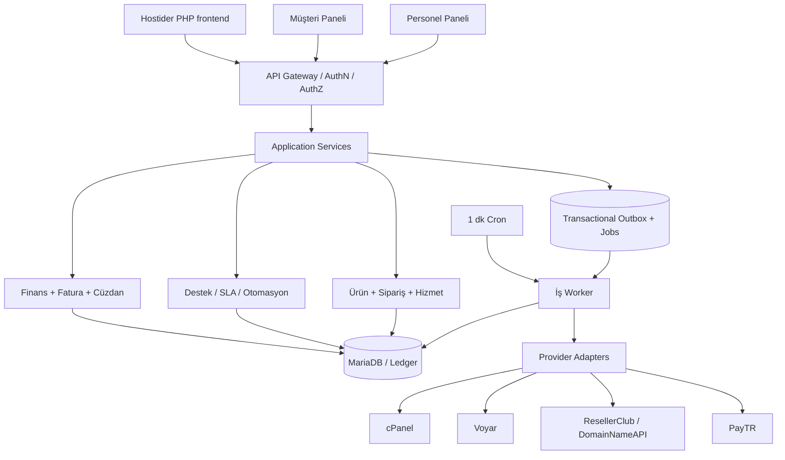

# 03 — Sistem mimarisi

## 1. Genel yaklaşım
- Modüler monolit: tek PHP deploy, tek transaction alanı, birbirinden ayrılmış bounded context'ler.
- PHP 8.3+; PDO ve InnoDB; MariaDB 10.11+ hedef; gereksiz framework ve sürekli açık worker zorunlu değil.
- Paylaşımlı hostingde 1 dk cron ile `queue:work --once`, `schedule:run`, `health:check` benzeri kısa ömürlü komutlar. HTTP güvenli idempotent işlerde API üzerinden; e-posta/sağlayıcı işleri cron üzerinden.
- Sunucu HTML render + hafif JS fetch/DOM bileşenleri; tüm etkileşimlerin versiyonlu JSON API karşılığı var. Tam sayfa refresh'e bağımlı değil; SPA framework şart değil.
- Arayüz katmanı → application service → domain/service policy → repository/transaction/outbox → adapters. Finans ve provisioning iş kuralları controller'da yaşamaz.

## 2. Modüller ve veri sahipliği
- Identity & Access: kullanıcı, müşteri rolü, 2FA, cihaz/oturum, API anahtarı, impersonation.
- Catalog & Pricing: ürün, varyant, opsiyon, fiyat listesi, vergi, FX snapshot, promosyon.
- Orders & Billing: sipariş, ödeme talebi/proforma, period, resmi fatura eki.
- Payments & Ledger: sağlayıcı attempt/callback, tahsilat dağılımı, wallet, refund, muhasebe hareketleri.
- Services & Provisioning: hizmet, konfigürasyon snapshot, sağlayıcı kaynak bağlantıları, yenileme, transfer, lifecycle.
- Registrars/Hosting/Compute: adapter arayüzleri; dış sistem DTO'ları bu sınırda dönüştürülür.
- Support: ticket, departman, e-posta, SLA, incident, CSAT.
- Notifications & Automation: şablon, outbox, scheduled notifications, rules.
- Operations: backup, update, health, audit, import.

## 3. Transaction sınırları ve asenkron işleme
1. Gelen olay doğrulanır: kullanıcı yetkisi / callback HMAC / payload geçerliliği.
2. DB transaction açılır; iş state transition yapılır, idempotency kaydı ve outbox event birlikte commit edilir.
3. API başarısı DB commit'inden sonra döner. Provider network çağrısı bu transaction'ın **dışındadır**.
4. Worker işi claim eder (lease, attempts, backoff, fencing token). Provider'e yazar; dönen sonucu normalize eder.
5. `SUCCESS` durumda harici resource ID ve kanıt saklanır. Timeout/undefined -> `UNKNOWN` ve reconciliation. Kesin `FAILED` retry politikası ayrıca belirler.
6. Event consumer'lar en az bir kez teslim alabilir; tüketiciler kendi idempotency kaydına sahip olmalıdır.

## 4. İdempotency ve concurrency
- HTTP mutasyon `Idempotency-Key` (istek+actor+scope) kullanır; sunucuda canonical request fingerprint ile eşleştirilir.
- PayTR `merchant_oid` eşsiz `payment_attempt` üstündedir; callback tekrar edilirse yeni ödeme oluşturulmaz.
- Sağlayıcı: `provider_operation_uuid`, hedef hizmet ve operation kind için unique/locked in-flight kuralı; servis oluşturma/transfer/terminate aynı anda koşmaz.
- Provider API dışarıdan idempotency desteklemiyorsa ikinci `create` çağrısı otomatik **yasak**; önce görünür kaynak sorgusu/reconciliation.
- Bakiye/harcama/ödeme tahsilatı tek DB transaction + satır kilidi + toplam kısıtı ile atomiktir.
- Optimistic lock için `version` alanı; update `WHERE id=? AND version=?` başarısızsa 409.
- Saat/kur/süre normalleştirmesi: UTC storage, IANA bölge takvimi, decimal-safe fiyat ve FX snapshot.

## 5. Scheduler ve queue
- Tablolar: `jobs`, `job_attempts`, `job_locks`, `outbox_events`, `inbox_events`, `scheduled_tasks`, `dead_letters`.
- Job alanları: id, type, payload_json, queue, run_after, status, attempts, max_attempts, lease_token, leased_until, dedupe_key, correlation_id, last_error_sanitized.
- 1 dk cron; kısa zaman/bellek sınırı; en az iki cron çakışması için kilitleme. Terminal/SSH olmadan web cron giriş noktası gerekiyorsa HMAC+IP+timestamp ile korunur; halka açık endpoint kontrolsüz çalışmaz.
- Kesin başarısız: iş dead letter'a taşınır; kullanıcıya yanlış aktif durum bildirilmez.
- Kritik SLA/ödeme job'ları, düşük öncelikli metriklerden önce işlenir.

## 6. Güvenlik ve gözlemlenebilirlik
- Oturum çerezi Secure/HttpOnly/SameSite; CSRF, rate-limit, XSS ve içerik güvenlik ilkesi; parola Argon2id mümkünse, PBKDF? yok; hash sürümleyerek rehash.
- Yönetici TOTP 2FA ve recovery, step-up auth. Müşteri hesabı politikası zorunlu/opsiyonel. İsteğe bağlı passkey V2 adayı.
- Yetki: endpoint + kayıt düzeyi (`customer_id`, `department_id`, `resource_owner`) kontrolü; deny by default; yetki önbelleği sürümlü.
- `impersonation` kısa ömür, sebep girme, actor+effective principal+scope audit; şifre/sanal kart/2FA/transfer onayı gibi riskli işlemleri varsayılan engelle.
- Kredi kartı PAN/CVV toplanmaz; PayTR hosted iFrame kullanılır.
- Secrets libsodium / envelope key; anahtar dosya/konfigürasyon webroot dışında; sürümleyerek rotate; audit log sanitization.
- Her işlem `trace_id`, `causation_id`; PII maskeleme; sağlayıcı ham hata response'u yalnız güvenli yönetici teşhisinde sınırlı gösterilir.
- Sağlık kontrolleri: son cron, queue backlog, dead-letter, payment callback drift, registrar/WHM/Voyar adapter auth, disk/database/backup age, mail failures.

## 7. Performans hedefi ve sınırlar
- Ölçek tasarımı başlangıçta <50 müşteri; iş tasarımında 1000+ kayıt/dönem büyümesine engel yok.
- Arayüz listeleri sayfalama/filtre/indeks kullanır; sayaçlar özet tablo+geçerlilik zamanı.
- Aktif ticket ekranında incremental polling (başlangıç ~5–10 sn, dinamik); diğer ekranlarda daha seyrek. WebSocket zorunlu değil.
- Büyük yedek/dump/ekler HTTP request içinde tutulmaz; job chunks, üst sınırlar ve checkpoint.
- Üretim öncesi ölçülecek SLO'lar: API p95, en uzun queue lag, webhook gecikmesi, başarılı job oranı, mail processing lag. Sayısal eşikler ölçülüp onaylanmadan 'garanti' yazılmaz.
