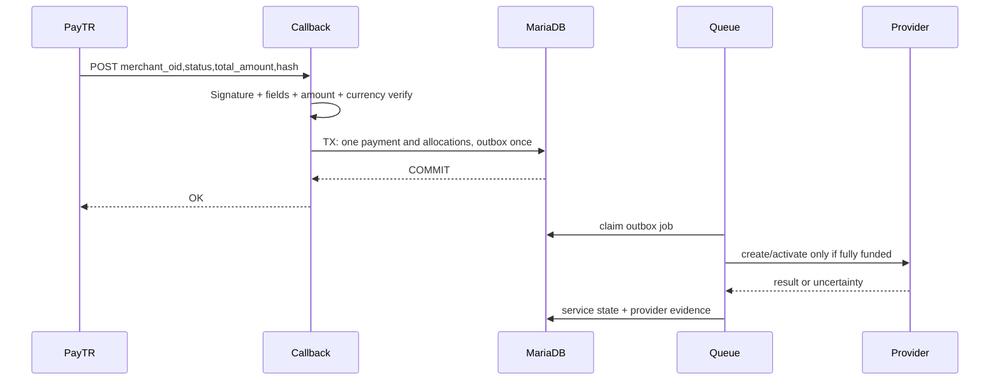

# 06 — Durum makineleri, saga ve istisnalar

## Sipariş / ödeme / servis ayrı state machine
```text
Order: DRAFT -> QUOTED -> AWAITING_PAYMENT -> PAID -> FULFILLING -> FULFILLED
                                                       \-> REQUIRES_APPROVAL
                                                       \-> FULFILLMENT_FAILED
         \-> CANCELLED / EXPIRED (uygun durumlarda)
PaymentRequest: ISSUED -> PARTIALLY_PAID -> PAID (veya VOIDED)
Service: PENDING_PAYMENT -> PENDING_APPROVAL? -> QUEUED -> PROVISIONING -> ACTIVE
                                        \-> FAILED/UNKNOWN -> MANUAL_REVIEW
ACTIVE -> SUSPENDED -> ACTIVE; ACTIVE -> CANCEL_SCHEDULED -> TERMINATING -> TERMINATED
```
- `PAID` customer charge confirmed; `ACTIVE` provider service availability verified. Farklı zamanlarda olur.
- Yönetici onay gerektiren ürün ödeme tamam olsa bile `PENDING_APPROVAL`; onay sonrası job.
- Sağlayıcı `UNKNOWN` durumunda otomatik tekrar `create` yapılmaz; personel+reconciliation.

## PayTR callback saga

- Müşterinin dönüş/başarı sayfası **ödeme kanıtı değildir**.
- Aynı callback iki kez gelirse `OK` ancak para ve provisioning ikinci kez yaratılmaz.
- Callback hash doğrulanmadıysa `OK` ile kabul yok.

## Sağlayıcı işlemleri
- Unified Operation: `operation_uuid, service_id, provider_account_id, action, request_fingerprint, status, external_request_id, external_resource_id, verification_evidence`.
- İstek ve yanıt tarihleri, normalize hata sınıfları: `TEMPORARY`, `DEFINITIVE`, `AUTH`, `RATE_LIMIT`, `UNKNOWN`, `UNSUPPORTED`.
- Ağ timeout: `UNKNOWN`; yanıt gelmedi diye 'başarısız' demek yasak; önce external discover/get.
- Termination: müşteri ve operator için geri alınamaz işlem uyarısı, grace kontrolü, bekleyen işler denetimi, provider kaynak durumunun doğrulanması, hizmet statüsü değişimi.
- Domain registration/renewal/transfer ve Cloud VM create/terminate yüksek mali sonuçlu olduğundan `UNKNOWN` tekrar gönderilmez.

## Yenileme, vade, askıya alma
1. Planlayıcı uygun gün ve cycle policy hesaplar; 30 gün/takvim ayı/özel döngü ayrıdır.
2. Fiyat koruma/bildirim kuralları + aktif price source değerlendirilir; yeni payment request ve snapshot.
3. Otomatik yenileme açıksa cüzdan yeterlilik+reserve+debit atomik, gerekiyorsa sağlayıcı uzatma sonucu doğrulanır.
4. Ödeme yoksa kategoride/üründe tanımlı bildirim ve gecikme; domain için registrar grace ve sona erme ayrı doğrulanır.
5. Cloud varsayılan 'pause/stop' işlemi sağlayıcı maliyetini mutlaka keser varsayılamaz; doğrulanmamış maliyet devam edebilir. Koruyucu termination politikası ürün bazında devrede.
6. Silmeden önce yetkiler, veri saklama, yedek ve müşteri bildirimi; sonucu mutabakat.

## Yükseltme / düşürme
- Provider capabilities `canUpgrade`, `canDowngrade`, `requiresRebuild`, `supportsProration` kontrol edilir.
- Quote farkı kalan süre + politika/indirim/vergiyle hesaplanır; ödeme alınır; ardından dış işlemi yap.
- Kurulum başarısızsa ödemeyi silme; borç/credit/refund telafisi kullanıcıya görünür.
- Düşürme hemen veya dönem sonunda; disk küçültme veriyi riske atabileceği için güvenli provider desteği olmadan V1 otomasyon yok.

## İptal ve iade
- `CANCEL_REQUESTED -> PENDING_POLICY -> CANCEL_SCHEDULED / TERMINATING -> TERMINATED -> REFUND_ELIGIBILITY -> REFUND_APPLIED`.
- Sağlayıcıda termination doğrulanmamışsa müşteri hizmetinin kaynak harcaması sona ermiş kabul edilmez.
- İade türü `none/prorated/manual`; ödenmiş dönem, tüketim, erken iptal kesinti, vergiler ve gateway iade limiti hesaplanır.
- Dönem sonunda iptal talebi geri alınabilir mi? ürün politikasına bağlı; bu davranış UI'da açık gösterilir.

## Müşteriler arası hizmet transferi
1. Gönderen uygun aktif hizmette transfer açar, hedef müşteriyi doğrulanan hesap referansıyla seçer.
2. Açık borç, ödenmemiş dönem, provider taşıma/mülkiyet kısıtları ve devam eden otomasyonlar kontrol edilir; borçluysa `BLOCKED_DEBT`.
3. Tek kullanımlık token ve süre, gönderici/alıcı iki onay; token sadece ilgili customer auth ile geçerli.
4. Son doğrulama transaction: pending invoice yok, aktif işlem yok, bütün onaylar geçerli, `service.customer_id` güncellenir, owner history kapatılıp yenisi açılır.
5. İki müşteriye bildirim ve audit; geçmiş resmi faturalar eski müşteriyle kalır. Yeni malik, geçmiş eski malikin destek/finans verisine otomatik erişemez.
6. Provizyon sağlayıcı hesabı fiziksel olarak aynı kalabilir; taşıma yalnız iç sistem sahipliği, fiziksel migration ayrı workflow.

## Domain provider failover
1. Domain availability ve TLD contact/policy, WHOIS yasası, premium fiyat, kayıt ücreti doğrulanır.
2. Birincil registrar `register` çağrısı; başarıysa harici kayıt/exp date saklanır.
3. Kesin başarısız ve kalıcı kaynak oluşturulmamışsa alternatif sağlayıcıya uyumluluk/fiyat/bakiye tekrar kontrol edilir.
4. Timeout/ambiguous -> `UNKNOWN`, alternatif denenmez, aynı domain için yeni charge yok. Registrar order/domain sorgusu ve manual reconciliation gerekir.
5. Sürekli hata durumunda müşteriye 'kayıt tamamlandı' mesajı gönderilmez.

## Support ticket state
- `NEW -> WAITING_STAFF -> WAITING_CUSTOMER -> (WAITING_STAFF | RESOLVED) -> CLOSED`.
- `ON_HOLD`'a yalnız politika izin verirse; SLA duraklatma hedefi olay kaydına yazar.
- `CLOSED -> REOPENED` departman politikasıyla; yoksa yeni ticket + old link.
- Dahili not hiçbir koşulda müşteriye açık notification oluşturmaz.
